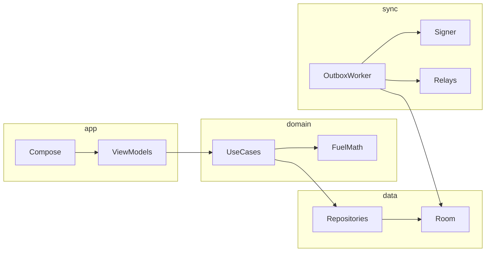
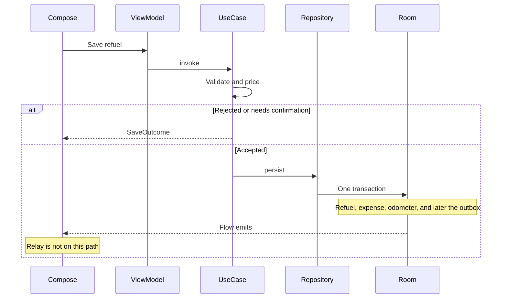
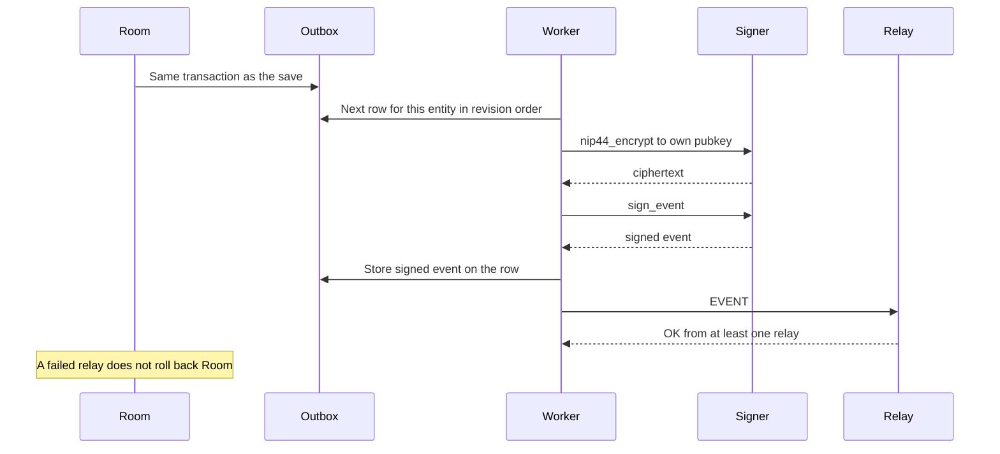
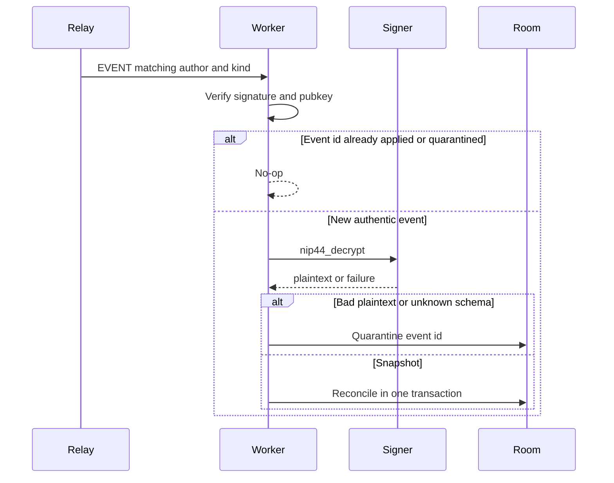

# Tankful — Native Android Vehicle Logbook

| | |
|---|---|
| **Author** | [Author] |
| **Date** | 2026-10-03 |
| **Status** | Draft |
| **Audience** | Senior Android engineers implementing the first release |
| **Repository** | Greenfield. The only existing file is `assets/icon.png`. There is no Gradle project, no application code, and no README yet. |
| **Implementation gate** | Do not start implementation until this design has been reviewed. This document is the deliverable. |

**Normative language.** "Must" and "must not" are binding. Sections marked **Design sketch** specify types and rules the code must follow; they are not files to add to the repository during design review. Where this document narrows the product brief, the challenge log states what changed and why. Do not invent a second product rule to fill a silence: if a case is not covered here, stop and ask rather than guessing a fuel or money rule.

---

## Overview

Tankful is a private, local-first vehicle logbook for Android. It records fuel, odometer readings, maintenance, and the rest of ownership cost for several vehicles, and it shows real consumption against an official figure when the two numbers are actually the same measurement. It is a native Kotlin and Jetpack Compose application. It is not a fuel-only toy, not a cross-platform wrapper, and not a cloud account with a phone client.

The phone's Room database is the operational source of truth. The UI saves locally before any network, signer, or relay call. Two other persistence concepts exist beside that database and must not be collapsed into it: an encrypted Nostr sync log, which is a convenience for the owner's other devices, and a versioned JSON backup the user holds themselves. Sync is not the database. A relay outage must never lose a refuel that Room already committed.

Money is integer minor units. Liquid volume is integer millilitres. CNG mass is integer grams. Distance is integer metres. Consumption is a full-tank-to-full-tank ratio, not an average of averages and not a figure invented from partial fills. Official specifications are manual everywhere, plus one automated United States EPA source. Italian pump prices can be suggested from the ministry's open data and are never written into a receipt by themselves. European type-approval numbers are typed in by the user in v1. There is no scraped OEM catalogue and no baked CO2 factor.

---

## Background & Motivation

A five-year owner needs one history per vehicle: fuel bought, what that fuel cost, how consumption moved, kilometres travelled, services, parts, insurance, tax, and what the car cost to own. They also want the official combined figure next to what the car actually did, without the app pretending a gap is a fault.

The usual failures in this category of app are product bugs, not missing screens:

- Partial fills reset or distort L/100 km.
- Float money drifts by cents and then gets re-summed from rounded unit prices.
- Different fuels, or a plug-in hybrid's weighted WLTP number, get compared with liquid litres.
- An odometer replacement creates a negative or absurd distance and a fantasy economy.
- The app will not save unless a server answers.
- A "sync" feature publishes expenses, plates, or VIN in clear text, or keeps only the latest document and drops the other device's offline edit.
- Official figures are scraped, mixed across WLTP, NEDC, and EPA, or estimated CO2 is labeled as a measurement.

Tankful's design exists to make those failures structurally hard. The calculation rules, the ledger, and the sync reconciliation rules below are written so tests can encode them without a second interpretation.

The brand mark already exists at `assets/icon.png`: a fuel-pump glyph on a glossy rounded square, warm orange on the left (`#FDA557` in the upper-left highlight, saturated orange around `#FA8240`) blending into deep blue on the right (`#123669` in the lower-right). The interface takes that palette and behaves like a night instrument cluster, not like a generic finance app and not like the glossy icon stretched into every screen.

---

## Goals & Non-Goals

### Goals

- Multiple vehicles, each with its own history, units, and official specification.
- Fast refuel entry that remains usable with no location permission, no signer, no relay, and no network.
- Fuel economy that a test suite can defend, including partial fills, open intervals, mixed fuels, and odometer corrections.
- A single money ledger so fuel and maintenance are not double-counted in ownership cost.
- Manual official-versus-observed comparison in the first feature milestone that shows a dashboard, with EPA lookup added later.
- Local reminders for insurance, tax, inspection, assistance, warranty, service, and odometer prompts.
- Portable backup via `tankful-export-v1` before any sync ships.
- Optional encrypted sync to user-chosen relays, including `ws://` on a LAN, without the app ever holding the user's private key.
- Light, dark, and system theme in the first production build, with the contrast and touch targets in the design system.
- A release build that does not depend on Google Play Services, so a strict F-Droid build stays possible.

### Non-Goals (v1)

- iOS, web, Flutter, React Native, Electron, or a WebView UI.
- A full battery-electric logbook, wallbox sessions, or MPGe analytics. The schema reserves an energy carrier value and then rejects it if something tries to use it.
- Electricity cost for plug-in hybrids. PHEV liquid fuel is in scope and is labeled liquid-fuel only.
- Live European official-spec search, EEA CSV shipping, or an offline "dataset pack".
- Fuel-price automation outside Italy's MIMIT open data.
- Scraping Wikipedia, auto-data sites, Spritmonitor, OEM configurators, or `https://carburanti.mise.gov.it/`.
- A numeric CO2 estimate from fuel. The type exists; the factor table does not.
- Gift-wrapped Nostr events, NIP-78 documents, NIP-04, or any feature that asks for an `nsec`.
- Syncing photograph or receipt bytes. Attachment metadata may roam; bytes stay on the device until a JSON/zip export.
- App-level PIN, crash SDK, analytics SDK, ads SDK, Tankful account, Tankful cloud, Firebase, and remote feature flags.
- Nominatim or any other geocoder. No address search.
- MPG as a displayed unit. The converter must already know the constants.
- Password-encrypted export. The file is plaintext and the share UI warns the user.
- A ranked "best car" across different fuels or currencies.
- Vendor tiles from `tile.openstreetmap.org`, Google Maps, or the Protomaps hosted tile API.

---

## Key Decisions

The body of this document is normative. This section is the index of decisions that everything else hangs on.

1. **Four modules, not a module per feature.** `:app`, `:domain`, `:data`, `:sync`. Hilt. Pure domain. minSdk 26. `applicationId` and namespace are `com.tankful.android`, from the first Gradle PR. No Gson, no Rx, no Play Services. Rationale: a logbook does not need a module graph bigger than its dependency directions; it does need the fuel math to be JVM-testable with no Android framework.
2. **Room is the source of truth.** Write path is UI → domain validation → Room transaction → Flow update. Outbox insert, when sync exists, is in that same transaction. The UI never waits for a relay. Rationale: offline use is the product, not a mode.
3. **Exact quantities where the math is money or fuel.** `Money` is ISO 4217 plus minor units. `UnitPrice` has an explicit scale (fuel prices use 3). Liquid quantity is millilitres. CNG is grams, not fake litres. Odometer is metres plus the entry quantum. Money, quantities, and consumption ratios are never `Double`. Coordinates are IEEE doubles and are not a `Quantity`. Rationale: 1.749 EUR/L cannot be cents, and float will fail the worked example; a fixed-point latitude would not make the economy more honest.
4. **Full-tank intervals, aggregate ratio, one series at a time.** Consumption opens at full tank A and closes at the next later full tank B of the same fuel on the same vehicle. A's quantity is excluded. Partials between them count and do not reset the interval. The headline average is total fuel over total distance in valid closed intervals of **that fuel**, not the mean of the rates and not a sum across fuels. Best, worst, the official delta, and the percent are computed only in fuel-per-distance (L/100 km or kg/100 km). km/L is formatting. Best means the lowest fuel per distance. Rationale: the unweighted mean treats a 30 km hop like a 600 km trip, and a km/L percent has the opposite sign.
5. **One ledger.** A refuel writes one linked Fuel expense in the same transaction. A maintenance record writes one linked expense for its total. Ownership and category charts sum expenses only. Volume and economy read refuels only. Unique constraints enforce the 1:1 link. Rationale: a nullable "fuel columns on expense" model gets double-counted the first time a chart joins both tables.
6. **Official data is narrow on purpose.** Manual specifications ship with the dashboard. The only runtime vehicle API is the US EPA fueleconomy.gov service, stored as EPA, never labeled WLTP. Europe stays manual. The only runtime price API is the Italian MIMIT CSV, labeled with the dataset's 08:00 date, and only copied into the form after the user confirms. OSM stations are Overpass, and the default map style is OpenFreeMap. The product owner confirmed this set on 2026-10-03. No other network source is in v1. Rationale: there is no honest global OEM API, and a wrong official number is worse than an empty field.
7. **No CO2 factor constants.** Domain type `EstimatedCo2` exists. v1 shows official type-approval or EPA tailpipe CO2 only. An estimate without a transcribed factor set is `Unavailable`, not a blog coefficient. Rationale: the 2025 DESNZ workbook was not transcribed; shipping a grams-per-litre constant would present an invention as a measurement.
8. **Maps are replaceable and optional.** MapLibre Compose pinned at 0.18.0 behind `MapTileProvider`. The UI stays on AndroidX Compose. The MapLibre location provider is not called; `LocationManager` is the only location API. Default style is OpenFreeMap, not OSMF raster tiles and not Google. Nearby stations come from an on-demand Overpass query, cached 7 days. The logbook works with the map removed. The `station_cache` migration is still a hard predecessor of the sync schema. Rationale: tile policy, ODbL, a no-GMS build, and a linear Room version history.
9. **Encrypt-to-self, regular events, full snapshots.** NIP-44 to the user's own pubkey via a NIP-55 signer. No gift wrap, no NIP-78, no NIP-04. One provisional regular kind, constant in one file, unregistered until checked immediately before sync is implemented. Reconciliation is a revision graph with explicit forks, not last-write-wins. Rationale: addressable events drop offline history; gift wrap requires this app to mint a signing key.
10. **Backup before sync, one DTO family.** `tankful-export-v1` uses the same content DTOs as the sync plaintext. Unknown fields are rejected. Tombstones are an exported `deleted` section so import cannot resurrect them. An interval judgement is one object, fields `id`, `openingRefuelId`, `closingRefuelId`, `confirmed`, in that order. Export stores that object, the envelope's `content` is that object, and the content hash is its canonical JSON. Revision and the other envelope fields are not on it. Tag links are `tagIds` inside the parent DTO, not a second entity. System category and service-type seeds are not synced. Rationale: a user must be able to leave the app without a relay, and two mappers will eventually disagree.
11. **Sync ships dark.** A settings toggle defaults off. Earlier milestones are usable builds with no publisher. Rollback of a bad sync build is "don't enable it" plus the JSON export. Room migrations are append-only.
12. **The home cluster is one vehicle and one fuel.** Selected vehicle id lives in DataStore and is not exported or synced. Deleting that vehicle selects the non-tombstoned vehicle with the earliest `createdAt`, then the lowest id, or clears the key. `createdAt` is a `vehicles` column set once at insert and a field of the vehicle content DTO. Purchase date is not the sort. Garage does not sum into the hero. The hero is the all-time full-tank average of the **primary** fuel, or the sentence "Fill to full to measure". A secondary fuel is a second labeled line, never a sum. Month spend and cost per distance are different measurements and are labeled as such.
13. **Lock-screen text is generic.** Reminders are local WorkManager work. Each kind has one sentence in the default English catalog, with no format arguments. Italian `values-it` for the primary screens, including these reminder sentences, ships in the first release. A translation replaces the whole sentence and must not interpolate plate, VIN, station, amount, or location. Nostr is not on the reminder path.
14. **Identity and theme.** Fixed brand palette from the icon. Dynamic colour off. Barlow Condensed for figures, Source Sans 3 for UI, both OFL, tabular figures on every metric. The glossy rounded square is not the adaptive-icon foreground.

---

## Challenge Log

These are places where a literal reading of the brief would produce wrong statistics, unsafe data handling, unreliable sync, or legally questionable acquisition. The adopted behaviour is the one in this document.

| Topic | Narrowing | Why |
|---|---|---|
| Gift wrap (NIP-59) | Not used in v1. Confidentiality is NIP-44 encrypt-to-self. | A kind 1059 wrap is signed by a one-time key this app would have to generate. That is not the user's nsec, but it breaks "Tankful never holds signing keys". The outer `p` tag would be the user's own pubkey anyway, so the recipient is visible. Relays also store 1059 poorly. |
| NIP-78 | Not the sync log. No plaintext app data. | Addressable events keep one latest document per `(kind, pubkey, d)`. Two offline devices: the relay discards one version. Access control via NIP-42 is not encryption. |
| NIP-04 | The signer method exists. Tankful must not call it. | Obsolete and unsafe. Allowed signer calls are only `get_public_key`, `sign_event`, `nip44_encrypt`, `nip44_decrypt`. |
| Unweighted mean of fill rates | Rejected. Headline average is total fuel over total distance. | A short urban hop would count as much as a motorway month. |
| "Hybrid" as a fuel | Hybrid and PHEV are powertrains. The stored fuel is petrol or diesel (or the secondary fuel). | Litres of "hybrid" cannot be summed with anything. |
| CNG as millilitres | Liquids stay millilitres. CNG is grams. Rates are kg/100 km and km/kg. | Italian metano is sold by mass. An invented density would manufacture economy. `energy_kind = LIQUID` still applies: in this schema it means chemical fuel versus a future electric carrier, not the physical phase. |
| PHEV versus WLTP | Percentage delta only if the stored official measure is liquid-fuel consumption of the same cycle. Weighted and charge-sustaining figures are shown beside the observed liquid rate with no percentage. Official 0 does not divide. | The weighted figure is a different experiment. |
| Zero-litre closed interval | Invalid, not 0.0 L/100 km. | Dividing a driven distance by zero fuel is a missed log, not a perfect car. |
| Low-confidence intervals | Kept in the overall average, excluded from best/worst until the user confirms, always visible on the chart, and called out with a warning that they affect the average. Never auto-deleted. | Dropping them hides real litres. Letting them win best/worst hides a typo. |
| Odometer replacement | Starts a new epoch. Intervals that cross the epoch are invalid. | Subtracting across a new cluster is a nonsense distance. |
| Revision integers | Parent pointer is `(baseInstallId, baseRevision)`, not the integer alone. | Each device has its own monotonic counter. Both will honestly number a divergent edit as revision 2. |
| Conflict display | Both snapshots are kept. Analytics keep using **this device's local head**, not the pre-conflict ancestor. | The ancestor reading would hide a save that Room already confirmed. Creates are new UUIDs and almost never conflict. The remote fork must not change totals until the user accepts it. |
| Ahead-of-head snapshots | Buffered as gaps, not dropped. | "Tolerate out-of-order delivery" is false if a snapshot whose parent has not arrived is treated as stale. Stale means the parent is **behind** the head and is not a known fork. |
| First enable | Publish one current full snapshot per entity, not the whole historical revision chain. A device with no row for that id accepts it. | Snapshots are complete. Replaying every edit is unnecessary traffic. |
| Tombstones versus replay | A tombstone dominates a replayed create. Export has a `deleted` section. Import must not restore those ids. | Otherwise backup/restore resurrects a deleted expense. |
| NIP-09 | Optional, default off, best-effort, not a promise. Kind 5 lists previously published **content** event ids only, never the tombstone. `content` is empty. Tags are `e` tags only. | Kind 5 is public, relays may ignore it, and ciphertext already stored cannot be made never to have existed. Deleting the tombstone event would throw away the semantic delete and leave the older snapshots in place. |
| Cleartext traffic | Global `usesCleartextTraffic` stays false. `ws://` is a separate socket path only for hosts the user added as relays. | Android's network security config cannot grow domains at runtime. Turning cleartext on globally would also cover map and ministry calls. |
| Photos | Not in Nostr. Zip sidecars for export. | Relay event size and NIP-44 via the signer are the wrong pipe for images. Practical plaintext target is under 8 KB. |
| Naive locale numbers | The fuel parser treats either `.` or `,` as the decimal mark and rejects a thousands separator. A preview shows the parsed value. | In `it-IT`, a naive parser reads pump-style `1.749` as one thousand seven hundred forty-nine. |
| Purchase price | A vehicle field, not an expense. "Ownership" on the dashboard is purchase price plus all expenses when the price is present, otherwise "expenses only". Month charts sum expenses only. | Logging the purchase as an expense double-counts it. Putting it inside "this month" swamps the chart. |
| No FX | Mixed currencies are never converted. | There is no verified rate source. A silent rate would invent cost/km. |
| Home hero | All-time interval average of the primary fuel, not the current month and not a sum with the secondary fuel. | One partial month is not a consumption measurement. Petrol and LPG are both litres and would otherwise be compared or added. |
| Display unit versus gate | Best, worst, the 20% gate, delta, and percent use L/100 km or kg/100 km only. | km/L is the reciprocal. Official 5.2 and observed 6.1 are +17.3% either way the screen formats the rate. Best is the lowest fuel per distance. |
| Relay page | `limit` is newest-first. The client walks backward with `until` and does not treat a full page as the whole log. The watermark is the newest `created_at` of the handled prefix, not the newest page. | A weekly `since=0` with `limit=200` would otherwise keep only the newest 200 events, and a watermark taken from that first page would skip an older event still awaiting the signer. |
| Cost per distance | Fuel money in the window divided by the odometer span of readings **in that window**. Not the consumption-interval distance. | The brief asks for both measurements and they answer different questions. The UI must not pretend they reconcile. |
| Lock screen | Even the vehicle model is omitted. The notification is the catalog sentence for that kind (§1.16). | Notification shade is visible over a lock screen. A user title might contain a plate. A locale may translate the sentence and must not add placeholders. |
| Device backup | `allowBackup=false` and extraction rules exclude the database, DataStore, and attachments. | Android backup would otherwise copy the financial history to the user's cloud without a Tankful cloud ever being designed. |
| VIN | No network decode. | Any decoder would send the VIN to a third party. Length 17 is a warning, not a hard fail. |
| GMS photo picker | Not used. Platform document picker, or the framework photo picker on API 33+. | The AndroidX backport can drag in Play services. |
| Location stack | Platform `LocationManager` only. Coarse location, in context. The MapLibre location provider is not used, even though the 0.18.0 POM pulls a location artifact. | Fused location from Play services breaks the F-Droid constraint. A second location stack would too. |
| MIMIT prices | Never auto-written. Not stored as the receipt's provenance. The label date is the price file's date column when the header has one, otherwise the published date minus one calendar day. Never `Instant.now()` alone. | The dataset is the 08:00 price, not the user's transaction, and the download clock is not that date. |
| EEA and OEM sites | No HTTP from the app. | The EEA files are a warehouse, not a phone catalogue. Scraping configurators is legally and technically unstable. |
| Kind number | `8472` is an arbitrary placeholder in the NIP-01 regular range. It is **UNREGISTERED / NOT A NIP**. | This design must not claim a kind allocation it did not verify. |
| Milestone order | Calculations move up to sit with fuel entry. JSON export moves ahead of Nostr. Manual specs move ahead of EPA. | A week of wrong L/100 km destroys trust. A backup must not wait for encryption work. |

---

## Proposed Design

### 1. Product and domain

#### 1.1 Language and information architecture

User-facing language is automotive: Garage, Fuel, Mileage, Consumption, Service, Maintenance, Expenses, Timeline, Insights. The words pubkey, relay, event, signer, and NIP do not appear on primary screens. They live under Settings → Sync → Nostr, with one-line explanations.

Bottom navigation, phone-first, four destinations:

| Destination | What it is |
|---|---|
| Home | Instrument cluster for the **selected** vehicle only |
| Timeline | Chronological history book for the selected vehicle |
| Insights | Filters, charts, and the multi-vehicle comparison |
| Garage | List of vehicles. No summed total |

Settings are a toolbar action, not a tab. Quick actions live on Home: Refuel, Expense, Odometer, Service.

One selected vehicle id is stored in DataStore (`selected_vehicle_id`). Switching vehicles changes that id. Home, Timeline, and the default Insights scope follow it. Garage never feeds a combined hero figure.

Empty states are one sentence and one action. No illustration set. Examples: "No vehicle yet", "Fill to full to measure", "No costs recorded".

#### 1.2 First run

Short state machine. No permission dialogs on this path. Nostr is optional. "Continue locally" is the primary button. "Connect a signer" is secondary and skippable; failure returns to the same choice rather than blocking.

1. Welcome.
2. Continue locally, or connect NIP-55. If the signer is missing, the user rejected it, or it timed out, the user continues locally. Connection rules are in the sync section; first run only needs the success and failure exits.
3. First vehicle, required fields: manufacturer, model, model year, fuel. Nothing else is required to finish.
4. Optional official specification. Skip is the default path. A US EPA search button may appear here only after that provider exists; until then the step is manual and skippable.
5. Current odometer, prompted and skippable. If entered, it becomes the first odometer reading, not a bare column on the vehicle.
6. Done. Home, with that vehicle selected.

The app is usable with nothing external configured: no signer, no relay, no map, no price file.

#### 1.3 Vehicles

Quick create collects manufacturer, model, model year, and fuel. Detail edit, available immediately after, adds the rest. None of the detail fields are mandatory.

| Field | Rule |
|---|---|
| `id` | UUID, stable, never edited, generated on device |
| `createdAt` | Instant, set once at insert, never edited later. The content DTO stores it with the canonical timestamp serializer (`2026-10-03T12:00:00.000Z`). The `vehicles.created_at` column stores that same instant as epoch milliseconds. It is not the purchase date, not envelope `updatedAt`, and not a Nostr event `created_at`. It is part of the vehicle content DTO, so export, sync, and the content hash all include it |
| Manufacturer, model, generation/variant | Text. Manufacturer and model non-blank at create |
| Model year, registration year | Year integers. Model year required at create. No vintage cutoff |
| Powertrain | `ICE`, `HYBRID`, `PHEV`. `ELECTRIC` is reserved and rejected if written |
| Primary fuel | `PETROL`, `DIESEL`, `LPG`, `CNG` |
| Secondary fuel | Optional, for bifuel. Must differ from primary. Not asked on quick create |
| Engine | Free text, optional |
| Power | Optional triple: unscaled amount, scale, unit `KW`, `PS`, or `HP`. Do not convert on save. Display what was typed. Factors, if a future sort needs them: 1 kW = 1000 W, 1 PS = 735.49875 W, 1 mechanical hp = 745.69987158227022 W |
| Transmission | Optional enum: `MANUAL`, `AUTOMATIC`, `DCT`, `CVT`, `OTHER` |
| Drivetrain | Optional enum: `FWD`, `RWD`, `AWD`, `OTHER` |
| Licence plate | Optional free text, max 16 characters. No country parser |
| VIN | Optional free text. If length is not 17, warn, do not block. Never send it anywhere |
| Purchase date | Optional local date |
| Purchase price | Optional `Money`. Not an expense row |
| Current odometer | Derived from the latest accepted reading in the latest epoch. Not an independently edited column |
| Preferred distance unit | `KM_WHOLE`, `KM_TENTH`, `MI_WHOLE`, `MI_TENTH` |
| Preferred economy unit | `L_PER_100KM` or `KM_PER_L` for liquids; `KG_PER_100KM` or `KM_PER_KG` for CNG. MPG values exist in the enum and are hidden |
| Notes | Optional, capped (see payload caps) |
| Image | Optional attachment reference |
| Last refuel defaults | Last fuel kind, last station name, last full-tank choice. Roam inside the encrypted vehicle snapshot |

User-facing fuel choices on quick create are petrol, diesel, LPG, CNG, hybrid, and plug-in hybrid. Mapping:

- Petrol, diesel, LPG, CNG → powertrain `ICE`, that primary fuel.
- Hybrid → powertrain `HYBRID`, then a required choice of petrol or diesel, default petrol.
- Plug-in hybrid → powertrain `PHEV`, then the same liquid choice.

Deleting a vehicle is a soft delete. One use case tombstones the vehicle and every child (specs, refuels, their linked expenses, odometer readings, maintenance and their expenses, reminders, interval judgements that cite those refuels, attachment **rows**). Tag links are rows in `entity_tags` removed in that same transaction because they are a projection of `tagIds` on the parent, not their own synced entity. Attachment **files** are removed from app storage in the same user action after the transaction commits; if file deletion fails, the rows stay tombstoned and a diagnostic lists the files. System categories are not deleted. The confirm dialog says the history will disappear from the garage and from totals. Analytics exclude tombstoned rows.

If the deleted id is the DataStore `selected_vehicle_id`, the same user action selects another non-tombstoned vehicle or clears the key. The replacement is deterministic and uses a column the table has: earliest `vehicles.created_at` (the `createdAt` field above), then lowest `id`. Purchase date is optional and is not the sort key. Home then shows that vehicle, or the empty garage state when none remain. It must not query a tombstoned id and it must not crash. The selected id is not exported and not synced. `createdAt` is exported, because it is part of the vehicle content DTO. `VehicleSelectionTest` locks this.

A date before the purchase date or before the model year is a warning, not a block. Owners backfill service done before they bought the car.

#### 1.4 Energy model

v1 logs chemical fuel only. The refuel column `energy_kind` is exactly the string the brief requires: `LIQUID` now, `ELECTRIC` reserved. Validation rejects `ELECTRIC` on write. Import of an `ELECTRIC` record is a malformed record in the preview, not a silent drop and not an electric UI.

LPG is liquid volume. CNG is mass. A bifuel vehicle keeps two series. Each series has its own average, its own chart, and its own official delta. The home hero is the primary-fuel series. The secondary series is a second labeled line under the hero, never a second number added into the first and never a blended rate. A hybrid's series is the liquid that was bought. A PHEV's series is the liquid that was bought and every consumer of that number labels it **liquid fuel only**.

Do not add electric tables "just in case". The reserved column is the migration avoidance.

#### 1.5 Quantities, money, and rounding

One rounding mode exists, `HALF_UP`, behind a single domain object. No other mode is allowed for money, quantity conversion, or display.

**Money actually paid** is `Money(currency, minorUnits: Long)`. EUR 74.68 is 7468. Aggregates sum `minorUnits` of the same currency. They never multiply a rounded unit price back through volume.

**Unit price** is `UnitPrice(currency, scale, unscaledAmount: Long)`. Fuel scale is 3. 1.749 EUR/L is `(EUR, 3, 1749)`. The form accepts at most 3 decimal places. A fourth decimal is a rejection, not a silent round. Currency of the unit price and the total must match.

**Liquid quantity** is integer millilitres. 42.70 L is 42700 mL. At most 3 decimal litres on input. Gallons convert only at the boundary:

- US gallon = `BigDecimal("3.785411784")` litres
- UK gallon = `BigDecimal("4.54609")` litres

10 US gallons → 37.85411784 L → 37854.11784 mL → **37854 mL**. The UI then shows the stored quantity back in the entry unit so the rounding is visible.

**CNG quantity** is integer grams. 5.432 kg is 5432 g. Price is per kilogram with scale 3. The same integer formula as litres applies because 1000 grams = 1 kg.

**Distance** is integer metres. Mile = `BigDecimal("1.609344")` km. A mile entry converts `HALF_UP` to the nearest metre (1 mile → 1609 m). Each reading also stores `entryUnit`, `entryUnscaled`, and `entryScale` so the form can show "10 mi" again. Display of a single reading uses that entry. Display of an aggregate uses the vehicle preference and does not invent decimals finer than that preference. Rounding one reading to the nearest metre is at most half a metre, so a difference of two readings is at most 1 m off the exact mile conversion. That is why metres are the stored unit. It is not a claim that the displayed one-decimal rate is immune to that metre: `100 * 10050 / 100000` is 10.05 L/100 km and displays as 10.1, while the same 10050 mL over 100001 m is about 10.0499 and displays as 10.0. Display from the exact millilitres (or grams) and metres. Do not persist the rounded display rate. Do not store a fractional metre.

**Derivation rules for a refuel or any unit-priced row:**

- Quantity and unit price, no total: compute the total `HALF_UP` to minor units and persist it. The unit price is user-entered, `derived = false`.
- Quantity and total, no unit price: the total is source of truth. Derive the unit price, store it `derived = true`, display at 3 decimals. Do not call it the posted pump price.
- Both entered: compute the total from quantity and unit price. If it differs from the entered total by **more than 1 minor unit**, `NeedsConfirmation`. If the user confirms, persist **both typed values** and set `amountsDisagreed = true`. If the difference is 0 or 1 minor unit, persist both as entered and do not warn.
- Aggregates always sum totals.

Integer formula, liquid or CNG, when 1000 smallest units make one major unit:

```text
minorUnits = HALF_UP( quantitySmallest * unitPriceUnscaled / 10^(priceScale + 3 - currencyMinorScale) )
```

For EUR (`currencyMinorScale = 2`) and a scale-3 price, the divisor is 10^4.

**Worked example, normative tests.**

42.70 L at 1.749 EUR/L. `42700 * 1749 = 74682300`. Dividing by 10000 gives 7468.23, which `HALF_UP` takes to **7468 cents = 74.68 EUR**. The exact product is 74.6823 EUR.

The same fill with a receipt total of 74.66 EUR is **7466 cents** if that is what was entered. Derived unit price = 74.66 / 42.70 = 1.748477… EUR/L, displayed and stored at scale 3 as **1.748** (`unscaled = 1748`, `derived = true`). The fourth decimal is 4, so `HALF_UP` does not move the third decimal. Re-multiplying 42.70 × 1.748 produces 74.6396 EUR, which would store as 7464 cents. That path is forbidden. A test must fail if any aggregate recomputes money from the derived unit price.

If the user types both 1.749 and 74.66, the computed total is 7468 and the difference is 2 minor units, so the form asks before saving.

Zero money is allowed (fleet fuel, a topped-up warranty). Negative money is a hard reject. There is no exchange-rate table. Two currencies on one vehicle stay two totals.

#### 1.6 Odometer

There is one reading table. Sources are `MANUAL`, `REFUEL`, and `MAINTENANCE`. Fuel entries carry an optional reading; they are not a second history. Sort order for a vehicle is `(timestamp, metres nulls last, id)`.

An independent odometer reading never opens or closes a fuel interval. It does participate in the cost-per-distance span and in "current odometer".

**Epochs.** Readings in one cluster share an `epochId`. A reading saved with reason `REPLACEMENT` starts a new epoch and may be any non-negative value. Later comparisons stay inside the epoch. Distance never subtracts across an epoch boundary.

**Validation against time-neighbours inside the epoch**, not against "the row most recently inserted":

- Hard reject: negative metres, missing vehicle, unparseable timestamp.
- Hard reject: timestamp more than 24 hours in the future.
- More than 5 minutes and less than 24 hours in the future: reject unless the user explicitly chooses "Save anyway" (timezone mistakes). At most 5 minutes ahead is accepted as clock skew.
- Lower than the previous accepted reading in time, or higher than the next reading in time: do not save until the user sets a reason, `CORRECTION` or `REPLACEMENT`.
- If the gap to the previous reading is greater than 0 and at most 36 hours, and the increase is above 2000 km (`2_000_000` m): `NeedsConfirmation`. The constant is `ODOMETER_JUMP_CONFIRM_METRES`. It is not a user setting in v1. A backfilled reading a month later with a large but plausible gap does **not** trip this check.
- Above 2_000_000 km: `NeedsConfirmation` (typo guard, not a law of physics).

Correction edits the reading in place from the user's point of view and writes a **new revision** of that entity. Intervals are recomputed because they are derived. Nothing is a dead-end error: every reject returns to the form with the fields preserved.

Reminder intervals, per vehicle: weekly (7 days), 2 weeks (14), monthly (**30 days**, not "the same date next month", so tests stay deterministic), 3 months (90), custom (1–365 days), disabled. Next due is the timestamp of the latest reading plus the interval. No reading yet means no scheduled nudge; first run already prompted. The notification posts the `ODOMETER_PROMPT` resource from §1.16. The English source of that resource is "Odometer reading due". A shipped locale may replace that sentence. The worker loads the resource. The English sentence is not the only legal text. The resource has no format arguments.

#### 1.7 Refuel

A refuel is the source record for quantity, fuel identity, full-tank flag, station, and the fuel total.

| Field | Rule |
|---|---|
| Vehicle | Required. Preselected to the selected vehicle, changeable |
| Timestamp | Default now. Same future-date rules as odometer |
| Odometer | Strongly prompted, skippable. Skipped means this fill cannot open or close an interval |
| Quantity | Required, positive, in the fuel's dimension |
| Fuel kind | Required. Defaults to the last choice for this vehicle, else the primary fuel. The user can pick the secondary fuel |
| `energy_kind` | `LIQUID` |
| Unit price and total | At least one. Derivation rules above |
| Full tank | Defaults to the last choice for this vehicle |
| Station | Optional free text. Optional OSM id and coordinates only if the user picked a station |
| Notes, tags | Optional |
| Receipt image | Optional attachment. Local file only |
| Linked expense | Required 1:1, category machine id `fuel`, created in the same transaction |

**Quick refuel** is this form and nothing else. Numeric keyboard. The parser in §1.5. Live preview of the parsed quantity and price. The computed side of `{unit price, total}` is visually marked as calculated until the user edits it. Notes and tags start collapsed. Station can be typed with zero network. "Nearby" is absent until location exists, and is never required.

Save commits even if the price suggestion, the map, the signer, or every relay is down.

**Transaction sketch (normative boundary, not a source file):**

```kotlin
db.withTransaction {
    insert Expense(origin = REFUEL, originId = refuelId, categoryId = "fuel", total = refuel.total)
    insert OdometerReading(source = REFUEL, sourceEntityId = refuelId) // only if the user entered one
    insert Refuel(expenseId = expense.id, odometerReadingId = reading?.id)
    // revisions and content hashes for each inserted entity
    // from the sync milestone onward, outbox rows go in this same transaction
}
```

Delete tombstones the refuel, the linked expense, and the odometer reading that this refuel created. It does not tombstone an unrelated manual reading. Edit of money updates the refuel and the linked expense in one transaction and writes new revisions of both.

Caps that keep a snapshot small: notes ≤ 2000 characters, ≤ 20 tags, each tag ≤ 40 characters, station name ≤ 120 characters. A payload that would exceed 8 KB of canonical plaintext JSON is rejected with "shorten the note" rather than split.

#### 1.8 Consumption methodology

This section is the contract for `ConsumptionIntervalTest`.

**Definitions.**

- A candidate opening or closing fill is a non-tombstoned refuel with `fullTank = true`.
- Two fills are in the same series if they share `vehicleId` and `fuelKind`. Powertrain does not create a series. `energy_kind` does not either, because v1 has only `LIQUID`.
- Order inside a series is `(timestamp, odometer metres with nulls last, id ascending)`. "Later" means later in that order, not merely a greater timestamp.
- A partial is `fullTank = false`. Partials before the first full tank are purchased fuel and expenses. They are in **no** interval.
- Odometer-only rows are not in the refuel list and cannot open, close, or extend an interval.

**Scan, per series.**

1. `open = null`.
2. On a partial: if `open` is set, the partial belongs to the open interval and changes nothing else. If `open` is null, ignore it for consumption.
3. On a full tank, if `open` is null: it becomes opening A. Its quantity will not be in the following numerator.
4. On a full tank, if `open` is set: it is closing B. Emit one interval result. Then B becomes the next opening.
5. After the scan, if `open` is still set, emit `Open`. There is no rate. The UI says "Fill to full to measure".

**Numerator and denominator for a pair (A, B).**

- Fuel = sum of quantities of series refuels strictly after A and through B, **including B and excluding A**, including partials in between.
- Distance = `metres(B) − metres(A)`.
- Liquid rate: `L/100 km = litres / kilometres * 100`. `km/L = kilometres / litres`.
- CNG rate: `kg/100 km` and `km/kg`, same shape.
- Do not convert CNG into litres. Do not sum two fuels into one numerator.

**Invalid, excluded from every rate, still visible as a data warning on the fill.**

| Condition | Reason code |
|---|---|
| A or B has no odometer | `MISSING_ODOMETER` |
| A and B are in different epochs | `METER_REPLACED` |
| Distance ≤ 0 | `NON_POSITIVE_DISTANCE` |
| Fuel sum ≤ 0 | `NON_POSITIVE_FUEL` |

Do not divide in any of those cases.

**Valid interval.** Keep the exact ratio as millilitres (or grams) and metres. The canonical rate is fuel per distance: L/100 km for liquids, kg/100 km for CNG. km/L and km/kg are display formatting of that rate (`100 / fuelPerDistance`) and are not stored. Do not persist the rounded display rate. Display `HALF_UP` to **1 decimal**. Percent deltas display at 1 decimal. Do not show four decimal places anywhere in the UI. `summarize` does not take a display unit.

**Worked interval, normative.**

| Fill | Odometer | Quantity | Full |
|---|---|---|---|
| A | 50000 km | 40.00 L | yes |
| Partial | 50300 km | 15.00 L | no |
| B | 50650 km | 28.50 L | yes |

Distance = 650 km. Fuel = 15.00 + 28.50 = **43.50 L**. The 40 L is not in the numerator. Rate = 6.692307… L/100 km, display **6.7**. km/L = 14.942528…, display **14.9**.

The same litres and metres convert, only for a unit test of the future MPG path, to **35.15 US mpg** at 2 decimals using the constants in §1.5. That number must not appear in the v1 UI. The test locks the formula:

```text
kmPerLitre = kilometres / litres
usMpg = kmPerLitre * 3.785411784 / 1.609344
lPer100km = 100 / kmPerLitre
kmPerLitre = 100 / lPer100km
```

UK mpg uses 4.54609 instead of the US gallon. Both identities live in one domain type, `FuelUnits`. Stored records stay in mL or g and metres.

**Chaining.** B is the opening of the next interval, so its 28.50 L is excluded from the next numerator. Consecutive full tanks with nothing between them consume exactly B's quantity over `metres(B) − metres(A)`.

**Overall average.** One average per series. Sum of fuel in **valid** closed intervals of that series divided by the sum of distance in those intervals. It is not the unweighted mean of interval rates, and it is not the sum of two fuels. A short valid interval still counts here; it has little weight.

**Best and worst.** Computed only on the canonical fuel-per-distance rate. Best is the **lowest** L/100 km (or kg/100 km). Worst is the **highest**. Eligibility: valid, single-fuel (true by construction of the series), distance ≥ 100 km (`100_000` m), and not low-confidence unless the user has confirmed that pair. Shorter valid intervals cannot win. Sorting the displayed km/L number and taking its minimum is forbidden: that minimum is the thirstiest car. A vehicle whose preference is `KM_PER_L` still picks best from L/100 km.

**Low confidence.** Evaluate the canonical rate, never km/L or km/kg. A valid interval is low confidence when any of these hold:

- L/100 km &lt; 1.5, or kg/100 km &lt; 1.5 for CNG
- L/100 km &gt; 30, or kg/100 km &gt; 30 for CNG
- a **comparable** official combined figure exists for **this series' fuel** and the canonical rate is under 20% of that figure after the official number has been converted into the same fuel-per-distance unit

An observed 40 L/100 km against an official 5.0 L/100 km is not under 20%, even though 2.5 km/L is under 20% of 20 km/L. An implementation that does the test in km/L is wrong. If the active spec's fuel is not this series, the 20% clause does not apply; the absolute 1.5 and 30 bounds still do.

Low-confidence intervals stay on the chart with a hollow marker and the accessible description "low confidence". They stay in the overall average. They stay out of best/worst until the user confirms the pair. Confirmation is an `intervalJudgement`: the four-field object in §3.6, whose `id` is the canonical pair string. It does not alter the litres. It roams, and the JSON export stores that same object, so a restore does not demote a confirmed pair and does not change best/worst. The dashboard must show a warning when one or more low-confidence intervals are inside the displayed average. The fix is the normal edit flow.

**Time filters and intervals.** An interval belongs to a window when its **closing** fill's timestamp is inside the window. The interval is atomic. Litres added before the window still count. The subtitle is "Intervals closed in this period". Do not prorate by days.

**Trend chart.** One point per closed interval of the series being drawn, at the closing fill's date. The home chart draws the primary series and, when a secondary fuel exists, a second line labeled with that fuel's name (solid versus a labeled dash-dot, not colour alone). Points are not added across series. A horizontal official line is drawn only for a series whose fuel matches the active spec for that fuel. No area gradient under the line.

**Open interval.** No point, no contribution to the average, copy "Fill to full to measure".

#### 1.9 Official figures versus observed

Comparison is a v1 feature because manual figures exist before any provider does.

An official specification is one row for one fuel, not a pile of unlabeled numbers:

- `fuelKind`: `PETROL`, `DIESEL`, `LPG`, or `CNG`. Required. This is the fuel the figures describe, not "the vehicle". Manual entry defaults it to the vehicle's primary fuel and the user can change it to the secondary fuel. It is never null.
- Combined, plus optional city, highway, urban, extra-urban. Each value is unscaled + scale + unit. Empty slots stay null.
- CO2, optional, unscaled + scale + unit (`G_PER_KM` or `G_PER_MI`). Never converted into the other unit silently.
- `testCycle`: `WLTP`, `NEDC`, `EPA`, or `OTHER`. Required.
- `measureKind`: `LIQUID`, `WEIGHTED`, `CHARGE_SUSTAINING`, `MPGE`, `UNKNOWN`.
- Provenance: `source` (`MANUAL` or `EPA_FUELECONOMY`), `sourceUrl`, `retrievedAt` (null for manual), `retrievalProtocol` (the string `manual` or `fueleconomy.gov/ws/rest`). The product word "protocol" is these two fields, `testCycle` and `retrievalProtocol`, so a driving cycle is never stored in a URL column.
- `isActive`. At most one active specification per `(vehicle, fuelKind)`. Petrol and LPG each get their own active row. A second active row for the same pair is a constraint failure.

EPA fills city, highway, and combined, with `testCycle = EPA`. The UI says EPA. Those values must not occupy a WLTP slot. WLTP/NEDC manual entry fills urban, extra-urban, and combined. The screen shows only non-null fields, each with its own label.

The dashboard delta uses **combined** only. City or highway alone never becomes the delta.

**Comparable** means all of the following, evaluated in fuel-per-distance after conversion, not in the vehicle's display unit:

- The series fuel equals `spec.fuelKind`. Petrol observed against an LPG spec is `NotComparable` even when both numbers are L/100 km. The same rule applies to the 20% low-confidence clause.
- There is an active spec for that fuel with a combined value &gt; 0.
- The combined value can be converted into L/100 km (liquids) or kg/100 km (CNG) through `FuelUnits`. km/L and the hidden MPG identities are inputs to that conversion. Mass and volume do not convert into each other. After this step the comparison space is fuel per distance only.
- For `PHEV`, `measureKind` is `LIQUID`. `WEIGHTED`, `CHARGE_SUSTAINING`, `MPGE`, and `UNKNOWN` are shown and do not produce a percentage.
- For other powertrains, `measureKind` is `LIQUID`. A record that contains only MPGe is stored as `MPGE` and is not run through the gasoline formula.
- The cycle is named in the label. Numbers are never rewritten into a different cycle.

Delta = `observed − official`, both already in L/100 km or both in kg/100 km. Percent = `(observed − official) / official * 100` in that same space. Positive means the car used more fuel per distance than the official combined figure. The display unit does not change the sign or the percent. Formatting to km/L happens after the percent exists.

**Worked comparison.** Official 5.2 L/100 km, observed 6.1 L/100 km. Difference **+0.9 L/100 km**, percent **+17.3%**. Words **above official**. The same pair displayed as km/L is about 19.2 and 16.4, and the percent is **still +17.3%**, not about −14.8%. `OfficialComparisonTest` locks both the L/100 km presentation and a vehicle whose preference is `KM_PER_L`. Negative is **below official**. Zero is **matches official**. The caption, always, when a delta is shown: "Conditions, load, weather, tyres, and route move this number." The UI must not say fault, error, failure, or inefficient.

If the measures are not comparable, show both numbers and the words **not comparable**, and do not show a percentage. If the official combined is 0, do not divide; there is no percentage.

PHEV observed copy is **liquid fuel only** wherever the rate appears.

#### 1.10 CO2

Official CO2 is whatever the active spec stores, labeled by source: "Type-approval CO2" for manual WLTP/NEDC/OTHER, "EPA tailpipe CO2" for EPA. It is not "your emissions".

`EstimatedCo2` is a domain type: `factorSetId`, `factorYear`, `scope` (`CO2` or `CO2E`), `fuel`, and a result quantity. v1 has no factor table. The only function exposed to the UI returns `Unavailable`. The dashboard does not render an estimated card. A test fails if a formatter prints a CO2 estimate without a factor set id.

The UK DESNZ / DEFRA 2025 set was published 10 June 2025 at `https://www.gov.uk/government/publications/greenhouse-gas-reporting-conversion-factors-2025`. A 2026 workbook was reported elsewhere and was **not** opened. Do not copy a grams-per-litre figure from a blog or from memory. A later milestone may transcribe the official workbook, cite the file, and only then fill `EstimatedCo2`. That number stays visually and verbally separate from official CO2 and is never called a measured tailpipe value.

#### 1.11 Expenses, categories, tags

System category ids are stable machine ids. Display names come from string resources, never from the id and never from the user's language as a key. Users cannot delete or rename system categories in a way that changes the id. Custom categories are user UUIDs with a required `parentGroup` equal to one of the system groups: `fuel`, `maintenance`, `repairs`, `consumables`, `legal`, `cleaning`, `accessories`, `other`. Analytics roll custom rows up to that group. A custom category cannot be a new root.

Seed ids:

| Group | Ids |
|---|---|
| Fuel | `fuel` |
| Maintenance | `maintenance.scheduled_service`, `maintenance.oil_change`, `maintenance.filters`, `maintenance.fluids` |
| Repairs | `repairs.mechanical`, `repairs.electrical`, `repairs.bodywork`, `repairs.glass` |
| Consumables | `consumables.tyres`, `consumables.brake_pads`, `consumables.brake_discs`, `consumables.wipers`, `consumables.battery`, `consumables.bulbs` |
| Legal / ownership | `legal.insurance`, `legal.vehicle_tax`, `legal.registration`, `legal.inspection`, `legal.tolls`, `legal.parking` |
| Cleaning | `cleaning.car_wash`, `cleaning.detailing`, `cleaning.products` |
| Accessories | `accessories.parts`, `accessories.electronics`, `accessories.interior`, `accessories.exterior` |
| Other | `other` |

An expense has a vehicle, a timestamp, one category, one `Money` total, an optional note, tags, and an origin: `STANDALONE`, `REFUEL`, or `MAINTENANCE`. Standalone expenses are the only ones the expense form creates. Origins `REFUEL` and `MAINTENANCE` are written only by those use cases.

Tags are a many-to-many relation on refuels, expenses, maintenance records, and vehicles. They are not a substitute for categories. The tag vocabulary row has a random UUID. Uniqueness of the name is the case-folded trimmed name. Display preserves the user's casing on first create.

The link is not its own entity. The parent content DTO carries `tagIds`, sorted lexicographically by UUID string, and that list is what sync and export persist. Room's `entity_tags` is rebuilt from `tagIds` in the same transaction that writes the parent, so queries can join. Two devices cannot mint two ids for one link, because there is no link id. System category rows and system service-type rows are seeds. They are not synced and they are not given revisions. Custom categories and custom service types are ordinary UUID entities and do sync. An expense or maintenance row references a category or service type by its stable id; a system id resolves to the local seed on every install.

Filters: vehicle, category (including a whole group), maintenance type, tag, fuel type, and the time range in §1.14. Filtering is a domain object, not Compose logic.

#### 1.12 Maintenance and providers

Maintenance is not just a category. A record has: vehicle, timestamp, optional odometer, service type, optional provider, labour `Money` optional, parts `Money` optional, **total** `Money` required, notes, attachments, tags, optional next recommended date, optional next recommended odometer.

Parts replaced are child rows (`MaintenanceItem`): description, optional cost, optional quantity. They are descriptive. The expense amount is the record's **total**, not the sum of children and not an extra expense per part.

If labour and parts are both present and `labour + parts` differs from `total` by more than 1 minor unit, `NeedsConfirmation`. On confirm, the expense still posts `total`, and `amountsDisagreed = true`.

Service types are a catalog. System ids and default categories:

| Service type | Default category |
|---|---|
| `oil` | `maintenance.oil_change` |
| `filters` | `maintenance.filters` |
| `coolant`, `brake_fluid`, `transmission_fluid` | `maintenance.fluids` |
| `brakes` | `consumables.brake_pads` |
| `tyres` | `consumables.tyres` |
| `battery` | `consumables.battery` |
| `general_service` | `maintenance.scheduled_service` |
| `timing_belt`, `plugs`, `clutch`, `suspension` | `repairs.mechanical` |

The default is overridable on the record before save. Custom service types are UUIDs; the user picks a category. Brake discs the user wants separate from pads are a second record or a standalone expense, not a second hidden expense under the same job.

Providers are garage-wide, not owned by one vehicle. Kinds: `MECHANIC`, `DEALERSHIP`, `BODY_SHOP`, `AUTO_ELECTRICIAN`, `TYRE_SHOP`, `INSPECTION_CENTRE`, `OTHER`. Fields: name (required), location, contact, notes. A maintenance record's provider is optional.

Deleting a maintenance record tombstones it, its items, its linked expense, and the odometer reading it created.

Next recommended date and odometer may spawn a `SCHEDULED_SERVICE` reminder. The reminder is not an expense. Firing it does not post money.

#### 1.13 Ledger integrity

Normative invariants, each with a test:

1. Every non-tombstoned refuel has exactly one non-tombstoned expense with `origin = REFUEL`, `originId = refuel.id`, `categoryId = fuel`, and the same `Money`.
2. Every non-tombstoned maintenance record has exactly one such expense with `origin = MAINTENANCE` and the maintenance total.
3. Summing fuel expenses equals summing refuel totals, per currency.
4. Ownership cost, category charts, and garage money columns **sum expenses only**.
5. Fuel volume, mass, and economy **read refuels only**.
6. The timeline shows a refuel row and hides the shadow fuel expense. It shows a maintenance row and hides the shadow maintenance expense. Standalone expenses appear as expenses.
7. No chart joins refuel totals and fuel expenses together.

Purchase price is added only on the dashboard ownership card and only in the all-time "since purchase" figure. If it is null, the card subtitle is "expenses only". It is not in category breakdowns.

#### 1.14 Distance cost, dashboard, insights

**Cost per distance**, distinct from consumption:

- Money = sum of refuel totals whose timestamps fall in the window, per currency. This equals the fuel-expense sum if invariant 3 holds. Use the refuel totals for this particular card so a broken link shows up in the ledger test rather than silently changing the card. The ledger test is the guard.
- Distance = metres of the last odometer reading in the window minus metres of the first, considering only readings inside the window, same epoch. If the readings in the window are not strictly increasing in time order, there is no rate and there is a data warning.
- If fewer than two readings, or the span is ≤ 0, there is no rate.
- For a metric preference (`KM_WHOLE` or `KM_TENTH`), cost per 100 km in minor units is `costPer100KmMinor = HALF_UP(totalMinor * 100_000 / spanMetres)`. The `100_000` is 100 km expressed in metres. It is not `totalMinor * 100 / kilometres` and it is not cost per 100 metres.
- For a mile preference, cost per 100 miles uses the same stored metres and `FuelUnits.mileKilometres` (1.609344 km, so 1609.344 m per mile), via `BigDecimal`, then `HALF_UP` to minor units: `costPer100MiMinor = HALF_UP(totalMinor * 100 * 1609.344 / spanMetres)`. No `Double` in this division.
- Worked case, normative, next to the 7468-cent fill. `totalMinor = 7468`, `spanMetres = 650000`. `7468 * 100_000 / 650_000 = 1148.923076…`, so cost per 100 km is **1149 cents** (11.49 EUR). The mile form of that same span is `7468 * 100 * 1609.344 / 650000 = 1849.012…`, so cost per 100 miles is **1849 cents** (18.49 EUR). `MoneyTest` asserts both.
- This span is **not** the sum of consumption-interval distances. The card title is "Spend ÷ odometer span". The home card uses the metric formula when the vehicle's distance preference is kilometres, and the mile formula when it is miles. The subtitle names the unit ("per 100 km" or "per 100 mi").
- A window underestimates distance when the car was driven before the first reading inside it. The odometer reminder exists so the user can put a reading near a boundary. Do not prorate.

**Home cluster**, one vehicle, current calendar month for the three small cards, all-time intervals for the hero:

- Identity: manufacturer, model, model year. Plate is not the title.
- Current odometer, or "No odometer yet".
- Hero: all-time overall average of the **primary fuel** at 1 decimal, with the unit. If that series has no valid closed interval, the hero is the sentence "Fill to full to measure", not 0.0, even when the secondary fuel already has a rate.
- When `secondaryFuel` is set, one second line: the fuel name, that series' average, and that series' own delta or "not comparable". Never a sum and never a single percent that mixes the two.
- Official combined and the delta for the hero series, or "not comparable", with the cycle name and the fuel name. The spec used is the active spec whose `fuelKind` equals the series.
- Three compact cards: fuel spent this month (all fuels, money, not a consumption mix), odometer span this month, cost per 100 km or per 100 miles this month using the formula above.
- A thin chart of the last at most 12 closed intervals of the primary series, the secondary series as the second line when it exists, and a dashed official line only where the spec fuel matches.
- Next service or next expiry, whichever is sooner, as one row.
- Quick actions.

If a low-confidence interval is inside the hero average, a text warning sits under the hero.

**Insights** has the time ranges: current month, last month, last 30 days, last 90 days, current year, previous year, all time, custom. Definitions are half-open instants `[start, end)` in the system time zone:

- Current month: local first day 00:00 inclusive through the next month's first day exclusive.
- Last month: the previous calendar month, same way.
- Last 30 days and last 90 days: `now` minus the duration, not calendar-aligned. "Last month" and "last 30 days" are different and the labels must not be swapped.
- Custom: the inclusive local end date runs through the start of the following local day, exclusive.

`DateFilterTest` must cover a DST spring-forward, a month boundary, and a custom single day.

Charts, both themes, text alternative as a list of points for the screen reader:

- Consumption versus official (intervals).
- Fuel unit price, spend, and volume or mass.
- Cost per km and per 100 km (span method).
- Monthly expenditure.
- Distance per month and per year.
- Ownership cost, maintenance, repairs, insurance and tax.
- Cost by category group.
- Maintenance cost.

**Garage comparison** is a table inside Insights, not a scoreboard. Columns: name, distance, fuel spend, maintenance spend, total expenses, cost per km, average consumption. The consumption cell is the **primary-fuel** average only, labeled with that fuel and its unit (`L/100 km` or `kg/100 km`, or the formatted km/L equivalent with the percent still coming from fuel-per-distance). If a secondary series exists, the same cell carries a second labeled line. It is not added to the primary figure and it is not a sort key. Default sort is name. Sorting by money is allowed only when every vehicle in the table uses the same currency; otherwise money columns do not sort. There is no cross-fuel ranking and no trophy.

#### 1.15 Timeline and search

Timeline is a query, not a Kotlin inheritance tree. A database view or a `UNION` projects:

- refuels
- odometer readings whose source is `MANUAL` (refuel and maintenance readings show up inside those rows, not again)
- expenses whose origin is `STANDALONE`
- maintenance records

Each row maps to a small sealed `TimelineItem` in the UI layer only. Shadow expenses do not appear.

Search is local. v1 uses FTS5 over notes, station name, provider name, category display name, tag, and service type. The FTS table is derived, not synced, not exported. Leading-wildcard `LIKE` is not the design: ten years of notes will feel broken, and FTS5 is one virtual table, not a new subsystem. Timeline rows are text. No thumbnail strip. The detail screen loads a single attachment. That keeps a 2 000-row list on a `LazyColumn` without a paging library.

#### 1.16 Reminders

Kinds: `INSURANCE`, `TAX`, `INSPECTION`, `ROADSIDE_ASSISTANCE`, `WARRANTY`, `SCHEDULED_SERVICE`, `ODOMETER_PROMPT`, `CUSTOM`.

They are local. WorkManager, inexact, periodic daily check, no network constraint. Exact alarms are used only if the user opts into a specific hour **and** the platform permission is granted (`SCHEDULE_EXACT_ALARM` / `USE_EXACT_ALARM` as required by the API level). If it is not granted, the UI says the nudge may arrive later that day, and the inexact worker still runs. Nostr is not involved.

Notification copy has no format arguments and no substitution of vehicle name, plate, amount, station, or location. The English table is the default-locale source (`values/strings.xml`). A translation replaces the whole sentence. It must not introduce placeholders. `values-it` ships in the first release (PR 21) with translations of the primary-screen sentences, including this reminder table. Those translations have no format arguments. Settings and sync help may stay English in that same release if time is short. `ReminderCopyTest` locks the English catalog as that default-locale source and asserts that every reminder resource, in every shipped locale, contains no format arguments. It does not require a translated `ODOMETER_PROMPT` to equal the English sentence. The privacy rule is the absence of user data, not "English is the only legal text". §1.6 posts this catalog resource.

| Kind | English source |
|---|---|
| `INSURANCE` | Insurance renewal |
| `TAX` | Vehicle tax due |
| `INSPECTION` | Inspection due |
| `ROADSIDE_ASSISTANCE` | Roadside assistance renewal |
| `WARRANTY` | Warranty ending |
| `SCHEDULED_SERVICE` | Service due |
| `ODOMETER_PROMPT` | Odometer reading due |
| `CUSTOM` | Reminder due |

The user-visible title inside the app may be specific. The notification does not use it. At most one notification per reminder per local day. Snooze is one day. "Renewed" asks for the next due date and does not create an expense. The user logs the payment as an expense themselves.

Default lead time is 7 days for dated reminders. The daily worker notifies when `today >= dueDate − leadTime`, through the due date, until dismissal, snooze, or renewal.

`POST_NOTIFICATIONS` is requested when the user turns a reminder on, not during first run.

#### 1.17 Validation summary

Hard reject, form preserved, no "save anyway":

- Negative or zero quantity. Zero is not a refuel; the user wanted an odometer reading.
- Negative money. Zero money is allowed.
- Missing vehicle, blank manufacturer or model on create, missing model year, missing fuel.
- Negative odometer.
- Timestamp ≥ 24 hours in the future.
- More than 3 decimal places on a litre, kilogram, or unit price field.
- Both `.` and `,` in one number, or more than one separator.
- Unit price currency different from total currency.
- `energy_kind = ELECTRIC` or an unknown fuel kind.
- Payload over 8 KB.
- A single total above 1_000_000 major currency units is **not** a hard reject; it is confirmation (typo guard). Volume above 2000 L or mass above 2000 kg is confirmation. A confirmed large value is stored.

Confirm to save:

- Odometer decrease or a violation of the next-reading order, and a reason must be chosen.
- Single-day jump over 2000 km, as defined in §1.6.
- Unit price and total disagree by more than 1 minor unit.
- Labour + parts disagree with the maintenance total by more than 1 minor unit.
- Timestamp between 5 minutes and 24 hours ahead, via explicit "Save anyway".

Correction is always edit-in-place from the user's perspective: new revision, derived intervals change because inputs changed, previous revision remains in the sync log once sync exists.

#### 1.18 Attachments

App-specific storage, `filesDir/attachments/<uuid>.<ext>`. Room stores the relative path, mime type, original filename, and optional sha256. Not a SQLite blob. Not a content URI that dies when the picker grant dies: copy the bytes in. The photo picker is `ACTION_OPEN_DOCUMENT` / `ACTION_GET_CONTENT`, and on API 33+ the framework photo picker is allowed. No `CAMERA` permission and no CameraX. No broad storage permission. No GMS picker.

One vehicle image, plus attachments on refuels and maintenance. v1 timeline does not decode lists of bitmaps.

#### 1.19 What roams, and what does not

Inside the encrypted sync log and inside the JSON export:

- Vehicles and their children (specs, refuels, odometer readings, expenses, maintenance, items, providers, reminders, the tag vocabulary, custom categories, custom service types).
- `tagIds` embedded in those parent content DTOs. Not a separate tag-link event and not a `tagLinks` array in the file.
- Last-refuel defaults on the vehicle.
- Interval judgements, each the four-field object in §3.6. The export array `intervalJudgements` stores that object, not an envelope and not a second schema.
- The singleton settings document: default currency, relay URL list, reminder lead-time default.
- Attachment **metadata** (filename, mime, sha256, relative path). Not the bytes, except in the zip sidecar of an export.

Not synced, and not exported as revisioned rows: system category seeds and system service-type seeds. Every install creates them from the migration. Export writes custom categories and custom service types only. Import resolves a known system id to the seed and does not open a conflict on it. An unknown id is a custom row and imports normally.

Device only, never synced, never exported:

- Theme.
- Signer package name and the granted-permission state.
- Notification permission state.
- Map tile cache, station query cache, MIMIT file cache.
- `installId` (random UUID generated at first launch, stored in DataStore, not `ANDROID_ID`, not a hardware id).
- Selected vehicle id and last map camera.
- Outbox, applied event ids, quarantine, FTS index.

`installId` exists so a conflict card can say "edited on another device" without naming the hardware.

---

### 2. External research

Facts below are from the verified brief of 2026-10-03. URLs are the primary sources. Nothing else is claimed as a live API, a licence, a kind registration, or an emission factor.

#### 2.1 NIP-55

`https://github.com/nostr-protocol/nips/blob/master/55.md` (raw: `https://raw.githubusercontent.com/nostr-protocol/nips/master/55.md`). Status: draft, optional.

Android signer IPC so the client never handles the private key. Methods on the signer: `get_public_key` (returns the user pubkey and the signer package name), `sign_event`, `nip04_encrypt`, `nip44_encrypt`, `nip04_decrypt`, `nip44_decrypt`, `decrypt_zap_event`.

The manifest must declare queries for `nostrsigner` `VIEW` / `BROWSABLE`. Intents use the `nostrsigner:` URI, extras `type`, `id`, `current_user`, and return through the Activity Result API. The `package` extra is allowed only on `get_public_key`. `rejected=true` together with `RESULT_OK` means the user rejected the request. `resultCode != RESULT_OK` means the signer failed; it does not mean the user rejected.

Permissions may be requested with `get_public_key` so the user can pre-authorize. The content resolver `content://<package>.<TYPE>` runs in the background only if the user remembered the permission. If the resolver returns null or a rejected column, Tankful must not fall back to an intent when the rejected column is set. The spec says the client SHOULD NOT fall back if the user chose always-reject.

Batch signing, if ever used, requires `FLAG_ACTIVITY_SINGLE_TOP | FLAG_ACTIVITY_CLEAR_TOP`, a results array, and a signer that is `singleTop`. v1 does not batch. One encrypt and one sign per event is easier to fail cleanly. The batch flags are documented so a later change does not invent a different IPC.

Amber (`com.greenart7c3.nostrsigner`, MIT, version observed 6.6.6 dated 2026-10-01, min Android 8.0) is an example signer, not a dependency. Cambium is another signer that proxies NIP-55 to a NIP-46 bunker and holds no user keys. Tankful does not implement NIP-46. The web `callbackUrl` flow is irrelevant.

#### 2.2 NIP-44

`https://github.com/nostr-protocol/nips/blob/master/44.md`. Versioned authenticated encryption: ECDH on secp256k1, HKDF, ChaCha20, HMAC-SHA256, padding. The Cure53-audited revision is the one in master as read on 2026-10-03. Theoretical maximum plaintext is 2^32 − 1 bytes, not 65535. Older secondary write-ups that still say 65535 are stale. Do not cite 65535, and do not plan around multi-megabyte events either.

The practical caps are relay event-size policy, commonly tens to a few hundred kilobytes, and the Android binder/intent limit on the signer hop. Tankful's cap is **8 KB of canonical plaintext JSON** per entity snapshot. Photos are not in the ciphertext. A whole garage is not one ciphertext.

Encrypt-to-self means `nip44_encrypt(plaintext, pubkey = the user's own hex pubkey)`. Any device that can ask the signer to decrypt with that pubkey can read it. Tankful stores the pubkey and the signer package name only.

#### 2.3 NIP-59, NIP-78, NIP-01, NIP-09

Gift wrap: `https://github.com/nostr-protocol/nips/blob/master/59.md`. Optional. Three layers (unsigned rumor, kind 13 seal with empty tags, kind 1059 wrap signed by a one-time key). Encryption is NIP-44. It is not a sync protocol. Rejected for v1; see the challenge log.

NIP-78: `https://github.com/nostr-protocol/nips/blob/master/78.md`. Kinds 30078 and 78. Explicitly not an inter-app interchange format. Relays SHOULD require NIP-42 AUTH and SHOULD serve events only to the author. That is access control. A relay that ignores the SHOULD leaks plaintext. Addressable semantics keep the latest event only. Rejected as the sync log. NIP-42 may be used later as defense in depth when the user's relay supports it. It is never the confidentiality mechanism. v1 does not require AUTH to function.

NIP-01 kind ranges: `https://github.com/nostr-protocol/nips/blob/master/01.md`. Regular events are `1000 <= n < 10000`, plus 1, 2, and 4–44. Replaceable events are 10000–19999 and kinds 0 and 3. Ephemeral events are 20000–29999. Addressable events are 30000–39999. Tankful mutations are **regular** so relays retain every revision. One kind only. Placeholder, in a single constant:

```kotlin
/** PROVISIONAL. UNREGISTERED. NOT A NIP.
 *  Arbitrary value inside the NIP-01 regular range.
 *  Before the sync milestone is implemented, check
 *  https://github.com/nostr-protocol/nips and a public kind registry.
 *  If this number is taken, change it before any event is published.
 */
const val TANKFUL_MUTATION_ENVELOPE_KIND: Int = 8472
```

No sensitive tags. Author plus kind is the filter. A public schema tag is unnecessary and is not used. Entity ids, plates, VINs, stations, amounts, and locations stay inside the ciphertext.

NIP-09 kind 5 deletion requests are public, list event ids, and relays may ignore them. Semantic delete is the encrypted tombstone. A settings switch "also send public deletion requests" defaults **off**. When it is on, kind 5 names previously published content event ids of that entity, never the tombstone event. Kind 5 `content` is an empty string. Tags are `e` tags only. Details are in §3.6.

#### 2.4 Maps and stations

OSM Foundation tile policy: `https://operations.osmfoundation.org/policies/tiles/`. `tile.openstreetmap.org` is donation-funded and is not a production tile CDN. Attribution, an identifying User-Agent, caching, and a ban on bulk download and pre-seed are required. Tankful does not ship it as the default basemap and does not hardcode it.

OSM data is ODbL: `https://www.openstreetmap.org/copyright`. Querying nearby stations inside the app with attribution is acceptable. Shipping a planet extract is out of scope. Do not republish a derived database.

Map library: MapLibre Compose, Android artifact `org.maplibre.compose:maplibre-compose-android`, version **0.18.0** observed on Maven Central about five days before 2026-10-03, BSD-3-Clause. The project's Android API is marked Beta. Style URL is swappable. `https://github.com/maplibre/maplibre-compose` and `https://maplibre.org/maplibre-compose/`.

Pin 0.18.0. Do not follow a 0.19.0 getting-started coordinate without a deliberate bump; 0.19.0 was published on 2026-10-01 and is not the version this design adopts. The 0.18.0 POM depends on `org.jetbrains.compose.foundation:foundation-android`, `org.maplibre.nativeffi:maplibre-native-ffi-android`, and `org.maplibre.compose:location-android`. It does not pull Play Services (that is a different artifact, `maplibre-compose-gms`, which this project must not add). Our screens stay on AndroidX Compose. Do not import `org.jetbrains.compose` from `:app`. The native FFI artifact on the classpath must be the one the 0.18.0 POM requests, not a newer FFI taken from 0.19 docs. The MapLibre location provider is forbidden: no call into `location-android`. If that artifact arrives transitively, it stays unused. The only location call in Tankful code is `LocationManager`.

Default style: OpenFreeMap (`https://openfreemap.org`), public vector tiles, commercial use permitted, no API key. Attribution required: OpenMapTiles (`https://www.openmaptiles.org/`) and OpenStreetMap. An OpenFreeMap credit is appreciated. MapLibre can draw the attribution control; the map PR still has to prove the control is visible. The public instance is a community service, not an SLA. The user can later replace the style URL. The app logs refuels with the map disabled. The design does **not** freeze a style.json path the brief did not quote. Implementation copies the current style URL from OpenFreeMap's own documentation into one constant, `DEFAULT_MAP_STYLE_URL`.

Do not default to the Protomaps hosted tile API. PMTiles self-host is a future escape hatch, not v1 work. Do not use Google Maps.

Overpass public instances, policy: `https://dev.overpass-api.de/overpass-doc/en/preface/commons.html`. Fair use is on the order of 10,000 requests per day and under about 1 GB per day, with priority to light users. Heavy use should run its own instance. The brief cites that policy and not a specific interpreter URL. The endpoint is one replaceable HTTPS constant, taken from the Overpass project's own documentation at implementation time. Tankful's query is on demand, amenity `fuel`, small radius, cached in Room for 7 days, with a User-Agent that identifies Tankful and contains no user data. No country prefetch. No Nominatim.

Our query, which is application text, not a claim about a response schema beyond OSM tags:

```text
[out:json][timeout:25];
(
  node["amenity"="fuel"](around:8000,LAT,LON);
  way["amenity"="fuel"](around:8000,LAT,LON);
);
out tags center;
```

Default radius `STATION_QUERY_RADIUS_METRES = 8000`. One explicit retry at `15000`. Map panning does **not** fire Overpass. Only the station-search action does, debounced, and only when the cache key is older than 7 days. The cache key rounds the centre to 2 decimal degrees so GPS jitter does not multiply requests. Absence of a `fuel:*` tag means unknown, not "not sold". Display `name`, `brand`, `operator`, and `fuel:*` keys that are `yes`. A small local mapping file translates known keys (`fuel:diesel`, `fuel:lpg`, `fuel:octane_95`, `fuel:cng`, and similar) to labels. Unknown keys stay visible on a secondary line. Title priority is `brand`, then `operator`, then `name`.

Tests use a synthetic one-element fixture written for the test, not a slice of the planet.

#### 2.5 Italian prices

Authority: Ministero delle Imprese e del Made in Italy (MIMIT), Osservatorio prezzi carburanti, legal basis art. 51 L. 99/2009.

Open data, daily CSV, not a live pump API:

- `https://www.mise.gov.it/it/open-data/elenco-dataset/carburanti-prezzi-praticati-e-anagrafica-degli-impianti`
- `https://www.mimit.gov.it/it/open-data`

Licence stated on that page: IODL 2.0. Format CSV. Since 10 February 2026 the field separator is pipe (`|`), not comma. Two files: anagrafica impianti attivi, and prezzo alle 8. Prices are those in force at 08:00 on the day before publication. Update is daily. Coverage is Italy and the fuels the ministry collects: benzina, gasolio, GPL, metano / L-GNC, GNL. Historical quarterly archives exist.

The consumer site `https://carburanti.mise.gov.it/` is a lookup UI. It is not a documented public API. Do not scrape it. Do not depend on third-party rehosts.

Column names are **not** in the brief. The parser is isolated. At implementation time it binds columns from the current header. If the header does not contain `|`, fail with "unexpected MIMIT file format" rather than guessing. File URLs are resolved from the open-data page's published links, not invented here and not scraped from the consumer site.

GNL may appear on a station's price sheet as a label. v1 vehicles do not gain an LNG fuel kind. Benzina, gasolio, GPL, and metano map to petrol, diesel, LPG, and CNG. Metano prices are per kilogram and must not be copied into a per-litre field.

The national file is cached on disk at most once per local day when the user asks for a suggestion. It is not inserted wholesale into the logbook database. A coordinate obviously outside the wide box latitude 35–48 and longitude 6–19 skips the download and returns `Unavailable`. That box is a fast negative filter, not a border. Inside the box, a suggestion still requires a selected station **with coordinates**. Match is a heuristic: haversine ≤ 150 m and (normalized name equality, or Levenshtein distance ≤ 2 on names of length ≥ 6). Normalization is Unicode NFKD, casefold, strip non-alphanumeric. Several candidates produce a list, not an automatic choice. The user confirms before a number is copied into the form.

The label is `MIMIT price as of 08:00 on YYYY-MM-DD`. The date is chosen in this order. Never use `Instant.now()` alone, and never use "local download day minus one" as a substitute for a date the file already carries.

1. Use the price file's date column when the header has one. Ministry metadata for the pipe files describes `Data di estrazione` as the morning the price was in force. If that header is present, it is the column. If it is absent and the header has exactly one date column, use that column. If several date columns exist and none is named `Data di estrazione`, fail with "unexpected MIMIT file format" rather than pick one. Do not hardcode a column the current header does not contain.
2. Otherwise use the file's published date minus one calendar day. "Published" is the date the open-data page or the file name gives for that drop, not the phone's download clock.

`retrievedAt` is stored only in the cache. That metadata is **not** written onto the refuel. Once the user accepts a number, it is their typed unit price (`derived = false` once they confirm the copy, `amountsDisagreed` unchanged). No MIMIT provenance columns exist on `refuels`.

Other countries, network failure, format failure: `Unavailable`. Manual price entry always works. Do not vendor a ministry CSV in the APK or in git. Tests use a two-line synthetic pipe file.

#### 2.6 Vehicle specifications

There is no global official OEM API. Do not scrape Wikipedia, auto-data, Spritmonitor, or manufacturer configurators.

**United States**, runtime provider. `https://www.fueleconomy.gov/feg/ws/index.shtml`. Administered by Oak Ridge National Laboratory for the US DOE and US EPA. Menu and vehicle web services, XML, no API key. Paths cited by the brief: `/ws/rest/vehicle/menu/year`, `/ws/rest/vehicle/menu/make?year=`, then model, options, and `/ws/rest/vehicle/{id}`. Bulk CSV is also published; v1 uses the menu flow, not a bundled CSV. US government work, public domain. Coverage: model years 1984 through current. The datasets page was observed updated 2026-09-29, including a preliminary 2027 file. Ratings are EPA city/highway/combined MPG and CO2 tailpipe g/mi, **not** WLTP. Store `testCycle = EPA`. The UI says EPA. Network optional; failure falls back to the manual form, which is already the primary path. Do not query on each keystroke. The button says "Search US EPA". Element names beyond city, highway, combined MPG, and CO2 g/mi are confirmed against the live XML at implementation time. If the payload offers only MPGe, store `measureKind = MPGE` and do not convert it with the gasoline formula.

**European Union**, not a phone API. EEA monitoring under Regulation (EU) 2019/631. FAQ: `https://www.eea.europa.eu/en/about/contact-us/faqs/where-can-i-find-the-co2-emission-levels-of-new-passenger-cars-and-vans-in-europe`. Dataset viewer: `https://co2cars.apps.eea.europa.eu/`. Licence on the 2025 provisional metadata: CC-BY 4.0, copyright holder Directorate-General for Climate Action (DG CLIMA), `https://creativecommons.org/licenses/by/4.0/`. Coverage: new passenger cars registered in EU-27, Iceland since 2018, Norway since 2019. Per-registration microdata, WLTP CO2 and fuel consumption where reported, NEDC in historical years, provisional versus final releases. Schema names change per publication (example seen: `co2cars_2024Pv29`). There is an analyst SQL endpoint; it is a warehouse interface, not a mobile catalogue, and the files are far too large to query per keystroke or ship in the APK.

No EEA HTTP from the app in v1. Manual entry is the European path. Test cycle is required. An offline dataset pack built later by a separate pipeline, with CC-BY attribution stored in provenance, is an explicit non-goal of milestones 1–11.

#### 2.7 Fonts and icon

OFL fonts only. Recommended and adopted: **Barlow Condensed** for figures, **Source Sans 3** for UI text. Obtain them from their upstream OFL distributions at implementation time. Do not bundle a commercial automotive face. Enable the `tnum` feature when the file exposes it. A screenshot test asserts that `11.1` and `00.0` have the same width. If Barlow Condensed's shipped file has no tabular figures, switch the figure face to another OFL condensed face that has them before release. Do not substitute a DIN or Eurostile clone.

`assets/icon.png` is the marketing mark. Adaptive icons on API 26 mask the foreground. Placing this already-rounded glossy square into the foreground double-masks it. M1 draws a separate foreground: the pump glyph only, transparent background, inside the 66 dp safe zone of the 108 dp adaptive canvas. The background layer is a gradient from `#F08A32` (top start) to `#123669` (bottom end). A monochrome pump layer is included for themed icons. The in-app toolbar mark is a single-colour pump in `textPrimary`, not the glossy bitmap.

---

### 3. Architecture

#### 3.1 Modules and dependency direction

```text
:app    → :domain, :data, :sync
:sync   → :domain, :data
:data   → :domain
:domain → Kotlin JDK, coroutines, kotlinx.serialization, javax.inject
```

`:domain` has no Android dependency and no Hilt dependency. `@Inject` from `javax.inject` is allowed so Hilt can construct use cases. `:data` must not depend on `:sync`.

| Module | Contents |
|---|---|
| `:app` | Compose UI, navigation, theme, Hilt wiring, WorkManager entry points, formatters, string resources |
| `:domain` | Entities, money, units, consumption, validation, use cases, repository interfaces, provider interfaces, transfer DTOs |
| `:data` | Room, DataStore, repository implementations, EPA, MIMIT, Overpass, tile-style constant, FTS |
| `:sync` | NIP-55 signer, event build/verify, outbox worker, relay pool, reconciliation |

Packages inside the modules, not more modules: `presentation`, `fuel`, `vehicle`, `expense`, `maintenance`, `transfer`, `nostr`, `maps`, `vehicledata`. Feature folders are packages under those.

Stack, versions current stable at implementation time except where this document pins one: Kotlin, coroutines, Flow, Jetpack Compose, Navigation Compose, Room, DataStore, WorkManager, Hilt, kotlinx.serialization. No Gson. No Rx. No Play Services. `applicationId` and namespace: `com.tankful.android`. minSdk **26**. compileSdk and targetSdk are the current stable at implementation time. `BuildConfig` flag for debug logging only.

Release uses R8. Keep the serialization generated classes. Debug enables StrictMode for disk and network on the main thread.

`Json` configuration for canonical bytes: `prettyPrint = false`, `explicitNulls = false`, `encodeDefaults = true`, property order equals declaration order in the DTO source. Timestamps are UTC with millisecond precision and a trailing `Z` (`2026-10-03T12:00:00.000Z`) via one custom serializer. UUIDs are lowercase hyphenated. Enums are `SCREAMING_SNAKE` names, never ordinals and never translated strings. A test snapshots the canonical bytes of the worked refuel.

Content hash is SHA-256 hex of the canonical JSON of the **content DTO only**. It excludes `revision`, `baseRevision`, `baseInstallId`, `updatedAt`, and `installId`. Those are envelope fields. Two identical receipts hash the same even if clocks differ. For an interval judgement the content DTO is the object in §3.6, and that same object is the export element. The hash covers `id` because `id` is a field of that object. It does not cover the envelope, and it does not cover a wrapper that repeats the object beside revision or `contentHash`.

#### 3.2 Runtime shape



ViewModels expose `StateFlow`. They do not compute L/100 km, money, or conflict rules. Collection uses `SharingStarted.WhileSubscribed(5_000)`. Database and network use `Dispatchers.IO`.

Room → domain mapping is explicit. The serializable transfer DTO **is** the domain content model use cases pass around. Room entities are a storage projection (columns, foreign keys, tombstone bits) and are not the export schema.

#### 3.3 Local write path



Target, not a measurement: the Room transaction for a refuel completes in well under 100 ms on a mid-range phone, and the next frame can show the row. The signer is not on this path. Dashboard cold read of one vehicle with about 2 000 refuels is a target of under 200 ms, checked in the polish milestone, not promised by the schema.

#### 3.4 Threads of persistence

| Store | Role | Survives |
|---|---|---|
| Room | Operational truth | Offline, airplane mode, no signer |
| Nostr events | Encrypted mutation log on user relays | Reinstall only if a relay still has the events and the user can decrypt |
| JSON / zip | User-held backup | Anything, including "no relay ever" |

Relay retention is not under our control. The JSON export is the durable backup. Sync is convenience. A heavy user (3 vehicles, 10 years, about 100 refuels per year plus expenses and services) stays **well under 50 MB** of structured data excluding photos. Order-of-magnitude check: roughly 5 000 rows at a couple of kilobytes each is about 10 MB, and five times that usage is still under the cap. Photos are the growth path. Sync volume is thousands of small events, not a stream. Five thousand ciphertexts of a few kilobytes are on the order of 20 MB published once.

#### 3.5 Providers

Interfaces live in `:domain`. Implementations live in `:data`, except the signer, which lives in `:sync` because it is Android IPC. Tests bind fakes. Hilt modules in `:app` choose the implementation.

Manual specification entry does not go through a network provider. It is a use case that writes a `VehicleSpecification` with `source = MANUAL`.

#### 3.6 Sync model

**Plaintext envelope** inside NIP-44, schema id exactly `tankful-sync-snapshot-v1`. Any other schema id is quarantined after a successful decrypt.

```json
{
  "schema": "tankful-sync-snapshot-v1",
  "entityType": "refuel",
  "entityId": "stable-id",
  "revision": 2,
  "installId": "uuid",
  "baseRevision": 1,
  "baseInstallId": "uuid",
  "contentHash": "hex",
  "updatedAt": "2026-10-03T12:00:00.000Z",
  "tombstone": false,
  "resolvesContentHashes": [],
  "content": {}
}
```

`content` is the same DTO JSON export uses for that entity. Export stores that DTO. It does not store a second schema that wraps the DTO in revision or hash fields. `resolvesContentHashes` is empty except on a conflict resolution. `updatedAt` is informational and is an envelope field, not vehicle `createdAt`. Business ordering uses the entity timestamp inside `content` and the parent pointer, never the Nostr `created_at`. The vehicle content DTO includes `createdAt` from §1.3.

`entityId` is a stable string, not always a freshly minted UUID.

| Entity | Id |
|---|---|
| Vehicle, refuel, expense, odometer reading, maintenance, maintenance item, provider, reminder, tag, custom category, custom service type, attachment metadata, spec | Random UUID, lowercase hyphenated, created once on the originating device |
| Settings | The fixed UUID `00000000-0000-4000-8000-000000000001` |
| Interval judgement | One object, used as sync `content`, as each `intervalJudgements` export element, and as the bytes that are hashed. Fields, in declaration order: `id`, `openingRefuelId`, `closingRefuelId`, `confirmed`. `id` is `openingRefuelId + ":" + closingRefuelId`, both lowercase UUIDs. Both devices compute the same string. Do not mint a third UUID. `id` must equal that concatenation; a mismatch is a malformed record on import and a quarantine on sync. Envelope `entityId` equals `id`. No other field is in the object |

The interval-judgement object has those four fields and no others. For the values below, the canonical serializer from §3.1 emits this UTF-8 text, and that text is what is hashed:

```json
{"id":"aaaaaaaa-aaaa-4aaa-8aaa-aaaaaaaaaaaa:bbbbbbbb-bbbb-4bbb-8bbb-bbbbbbbbbbbb","openingRefuelId":"aaaaaaaa-aaaa-4aaa-8aaa-aaaaaaaaaaaa","closingRefuelId":"bbbbbbbb-bbbb-4bbb-8bbb-bbbbbbbbbbbb","confirmed":true}
```

`confirmed` is always present (`encodeDefaults = true`). The envelope around that object still carries `schema`, `entityType`, `entityId`, `revision`, `installId`, `baseRevision`, `baseInstallId`, `contentHash`, `updatedAt`, `tombstone`, and `resolvesContentHashes`. Those names are not fields of the object. `contentHash` is the SHA-256 hex of the canonical object, not of the envelope.

Tag links have no id and no snapshot. The parent's `tagIds` (sorted) are the link. Applying a parent snapshot replaces that parent's `entity_tags` rows in the same Room transaction. System category and system service-type seeds have no snapshot either. A parent that references an unknown **custom** category or service-type id is buffered with the gap snapshots until that id exists. A reference to a known system id is not unknown after migration.

**Nostr event.** Kind `TANKFUL_MUTATION_ENVELOPE_KIND`. Tags empty. `content` is the NIP-44 ciphertext. `created_at` is the actual publish time in seconds. Do not randomize it: NIP-01 relays may reject a far-future time, and the watermark depends on it. Relays therefore see the author's pubkey, the kind, the time, and the ciphertext length. They do not see the payload. That metadata leak is accepted and stated in Settings when the user turns sync on.

**Publish path.**



Once a signed event exists on the row, retries reuse it. A second signature would create a second event id for the same snapshot. Receivers would no-op on the content hash, but the log would grow and acks would split. Signing again is allowed only if no event id was stored.

**Outbox states:** `pending`, `awaiting_signer`, `publishing`, `acknowledged`, `failed`. `failed` is not terminal and does not delete the row. It means the last attempt failed; backoff continues. Unique key `(entityType, entityId, revision)` on this device's own revisions.

Per-relay ack map. The user-visible synced state is true when **at least one** configured relay has accepted the event. Other relays keep retrying with exponential backoff capped at 6 hours. Removing a relay drops its ack entries and does not delete Room data. Adding a relay backfills **current snapshots** to that relay only. Zero relays: rows stay `pending`, the app is fully usable, nothing is published. The worker no-ops while the sync toggle is off.

Backoff and a single in-flight publish. No socket per event. Reconnect is the same backoff.

**Signer outcomes.**

| Observation | Meaning | Behaviour |
|---|---|---|
| No package resolves `nostrsigner` | Signer not installed | Sync paused. Local data saved. Settings explains how to install a NIP-55 signer. Amber may be named as an example, not linked as a dependency |
| `RESULT_OK` and `rejected=true` | User rejection | `awaiting_signer`. Do not tight-loop |
| Resolver sets the rejected column | Always-reject | Do **not** fall back to an intent |
| `resultCode != RESULT_OK` | Signer failure | Retry with backoff |
| No result in 60 s | Timeout | `awaiting_signer`. Defined timeout is 60 seconds |
| Process death or app switch | Activity Result contract is registered on the Activity | Outbox row still there. Resume |
| Malformed signer JSON | Bad response | Do not touch the domain row. After 5 malformed responses, stop and ask the user |
| Decrypt failure or unknown schema, authentic event | Quarantine by event id | Do not retry forever. Settings → Sync shows the count |
| Author pubkey is not the logged-in pubkey, or signature invalid | Not our event | Drop. Do not add it to the quarantine count |

After the first successful `get_public_key`, persist the pubkey and the package name. Later intents set that package explicitly so a second app cannot intercept them. If the package disappears, show the chooser once and replace the stored package only after a new `get_public_key`. Verify every returned event: pubkey matches, id matches the NIP-01 hash, signature verifies locally with a JVM secp256k1 verifier. Verification does not go through the signer. The library is chosen at implementation time; this design does not pin a coordinate it has not verified.

Onboarding requests remembered permissions for `sign_event` of this kind, `nip44_encrypt`, and `nip44_decrypt`. If the user does not grant background permission, the outbox waits in `awaiting_signer` and the UI says signing needs confirmation. The notification text is `Sync needs a signature`. No amounts, plates, or counts of money. Tapping it opens the app, which then runs the intent.

There is no `nsec` field. If pasted text looks like one, reject it with "Tankful never asks for a private key. Use a signer app." and do not store it.

**Cleartext.** `network_security_config` sets `cleartextTrafficPermitted=false` on the base config. EPA, MIMIT, Overpass, and tiles are HTTPS. An `http` URL for those is refused. `wss://` relays use OkHttp with normal certificate validation. No trust-all. `ws://` is allowed only after the user adds that exact host and port and accepts a warning: transport is not encrypted; NIP-44 still protects the payload; the relay and the network can see that sync happens, when, and the public key. Because the platform cleartext policy is enforced by the HTTP stacks and not by a raw TCP socket, the `ws://` client uses `java.net.Socket` and a small WebSocket handshake **only** inside the relay connector and **only** for allow-listed hosts. No other feature may use that socket path. This is not `usesCleartextTraffic=true`.

**Inbound path.**



REQ filter: `authors = [pubkey]`, `kinds = [tankful kind]`, `since` as below, and `limit = 200`. The limit is our client choice. NIP-01 applies it newest-first. It is not a promise that the relay's first response is the whole log, and a relay that returned a full page has not finished the scan.

Paging, per relay, one pass:

1. `since` is `watermark − 48 hours` for the periodic pass. Manual "sync now" and the weekly pass use `since = 0`. The first REQ has no `until`.
2. On each page, before any watermark write: verify, drop a bad signature or a foreign pubkey, skip an event id already applied or quarantined **before** decrypt, otherwise decrypt and reconcile or quarantine. A dropped bad signature or foreign pubkey is settled. An event still waiting on the signer is not handled.
3. Do not write the watermark at the end of a page. Do not set it to the maximum `created_at` on the newest page. An event awaiting the signer does not stop the cursor and does not skip older pages. When the cursor stops (step 4 or step 6), apply the watermark rule once.
4. If the page contains fewer than 200 events, stop. A short page is the end of the cursor.
5. If the page contains 200 events, the next REQ keeps the same `since` and sets `until` to the oldest `created_at` in the page. NIP-01 will return newest-first again, now bounded by that timestamp. Events with that exact `created_at` can repeat. Skip event ids already seen in this pass. Those duplicates do not count as progress.
6. Stop when a page adds no new event id. That is a stuck cursor, surfaced in sync diagnostics. It is not success. Do not describe "the relay ignored `limit`" as a way the scan completes.

**Watermark rule.** One rule. A short page (step 4) means this pass has walked the range down to `since`. A stuck cursor (step 6) has not: the unread older side is a gap. Order the walked events by `(created_at, event id)`. The handled prefix is the longest leading run of that order in which every event has been applied or quarantined, starting at the oldest walked event only when no older gap remains. A dropped bad signature or foreign pubkey is settled and stays in the run. The run stops at the first event still awaiting the signer. The run also stops at a gap, including the unread pages below a newest-first page and the unread side of a stuck cursor. The watermark is the newest `created_at` for which every event at or before that timestamp in the handled prefix has been applied or quarantined. If an event outside the run shares that `created_at`, the timestamp does not qualify; use the newest earlier `created_at` that lies entirely inside the run. Do not advance the watermark over a gap. Do not advance it over an event waiting on the signer. Do not move it to "now". Do not move it to the newest page while an older event is still unread or still awaiting the signer. Write that prefix timestamp. If it equals the stored watermark, leave the stored value. If an unhandled event sits at or before the stored watermark, write the earlier prefix timestamp so a later periodic `since` cannot skip that event. Weekly and manual passes still use `since = 0`.

Known event ids are not decrypted again. `RelayPagingTest` builds 250 events, serves the newest 200 on the first REQ, and asserts a second REQ whose `until` is the oldest `created_at` of that page. The entity that exists only in the older 50 must reconcile. Repeating the first filter without `until` is a test failure. The same test leaves one event in that older page awaiting the signer and asserts the watermark does not become the newest page's `created_at`, and does not advance past that awaiting event.

Ignore, after verification, anything whose author is not the logged-in pubkey. The filter is not trusted: relays can lie.

**Reconciliation.** Apply inside one Room transaction that also inserts the event id into `applied_events`. A crash before commit retries safely.

1. Same event id twice: no-op.
2. Same entity id and same content hash: no-op. Record the event id.
3. Tombstone already stored for this entity, and the incoming snapshot is not a fast-forward **past that tombstone** (parent pointer equals the tombstone head, `tombstone = false`): do not resurrect. A replayed create (`baseRevision` null) after a tombstone does not restore the row.
4. Entity unknown locally and not tombstoned: insert, even if `baseRevision` is non-null. This is how a one-snapshot backfill lands. Diagnostic: condensed history.
5. Parent pointer `(baseInstallId, baseRevision)` equals the local head: fast-forward. Replace the head.
6. Parent pointer equals the parent of the local head, and the content hash differs: **fork**. Insert the incoming snapshot into `snapshot_fork`. Do not change the head. Open one conflict for that entity.
7. Parent pointer is an ancestor already known, behind the head, and not case 6: stale. Keep the event id. Do not change state. Surface it in sync diagnostics.
8. Parent pointer is unknown and the entity exists: **gap**. Store the snapshot in `pending_snapshots`. Apply it if a later event fills the parent. Do not spin. Diagnostics show "missing revision".
9. Tombstone snapshot that fast-forwards: hide the entity from UI and analytics. Keep the row so replay cannot recreate it.
10. Resolution snapshot whose `resolvesContentHashes` contains the local head's content hash: it becomes the new head and open forks for those hashes close. If the local head's hash is not in the list, treat it as a new fork against the resolution. No silent last-write-wins.

Until the user resolves a fork, analytics and the editor show the **local** head. The other snapshot is fully stored so the card can show both. The card copy is "Two versions of a record need a decision." Resolution writes a new snapshot on this device: revision = this install's next integer, parent = the local head, `resolvesContentHashes` = both hashes, content = the user's choice or the field merge. The other device converges by rule 10.

Creates dominate the log. A new refuel is a new UUID. Conflicts happen when two devices edit the **same** record while offline. Say that in the settings help so nobody expects a CRDT lecture in the UI.

Settings are one entity with a fixed id `00000000-0000-4000-8000-000000000001`. They use the same rules. Theme is not in that document.

**First enable** of the toggle enqueues one current snapshot per non-tombstoned synced entity at its current revision, plus one tombstone snapshot per tombstoned id that must not resurrect. Synced entities include judgements and custom catalogs. They do not include system seeds, `entity_tags` rows, or the selected vehicle id. It does not replay intermediate revisions. Subsequent edits enqueue incrementally, in revision order per entity. The worker publishes the lowest unpublished revision of an entity first. A parent publish carries the current sorted `tagIds`.

**Backfill of old local data** when the sync tables first appear: revisions already live on the rows from the earlier milestones. The enqueue happens only when the user turns the toggle on. Nothing is published by installing the build.

**Quarantine UI:** Settings → Sync shows "Unreadable events: N". Event ids sit behind an advanced disclosure. Nothing is uploaded.

**Optional NIP-09** when the user opts in. Default off. The UI says relays may ignore the request, that a kind 5 does not recall ciphertext anyone has already stored, and that real deletion means wiping a relay the user controls.

Kind 5 is not a Tankful snapshot and it is not encrypted. It is a public NIP-01 event of kind 5. `content` is the empty string. The only tags are `e` tags. There is no reason string.

The ids in those `e` tags are previously published **content** event ids of the entity being deleted: snapshots whose plaintext had `tombstone = false` and that at least one relay accepted. The tombstone event id is never included. Putting kind 5 on the tombstone would ask relays to drop the semantic delete and leave the older ciphertext in place.

Those content event ids outlive the outbox row. When a relay accepts a non-tombstone event, insert `(relay_url, event_id, entity_type, entity_id)` into `published_content_events` in the same transaction that records the ack. Deleting the outbox row after a full ack does not delete that table. A tombstone acceptance does not insert a row.

After the tombstone snapshot has been signed, and only if the switch is on, build one kind 5 whose `e` tags are the stored content event ids for that entity. Sign it once via NIP-55, store the signed event, and retry that same event. Do not sign a second kind 5 for the same id set. Local tombstone behaviour does not depend on the kind 5 being accepted. `SnapshotReconcileTest` publishes kind 5 for the old content ids and then replays the pre-tombstone snapshot; the tombstone still wins and the row stays hidden.

#### 3.7 JSON backup

Schema id exactly `tankful-export-v1`. JSON Schema draft 2020-12 at `schemas/tankful-export-v1.schema.json`. `additionalProperties: false`. This file is not the Room schema export; Room's generated schemas stay in the data module's schema directory.

A plain `.json` file is valid. A zip `tankful-backup-v1.zip` contains `export.json` plus `attachments/…`. Text backup does not wait on photos. Missing sidecars are listed; the records still import.

Top-level members: `schema`, `exportedAt`, `appVersion`, `vehicles`, `specifications`, `refuels`, `odometerReadings`, `expenses`, `categories`, `maintenanceRecords`, `maintenanceItems`, `serviceProviders`, `serviceTypes`, `reminders`, `tags`, `intervalJudgements`, `attachments` (metadata), `settings`, `deleted`. No `tagLinks` array. No theme, no install id, no selected vehicle id, no signer package, no outbox, no tile cache.

`categories` and `serviceTypes` in the file are **custom** rows only. Parents that use a system id still carry that id; the seed is not a row in the file. Each tagged parent includes sorted `tagIds`. Each vehicle element includes `createdAt` from §1.3. `intervalJudgements` stores the §3.6 object and nothing else: `{ id, openingRefuelId, closingRefuelId, confirmed }`. That element is not wrapped with `revision`, `contentHash`, `installId`, `updatedAt`, `baseRevision`, or `baseInstallId`. There is no second judgement schema. A judgement tombstone is an entry in `deleted` with that same `id`. Import writes the judgement back before best/worst is computed, so a confirmed pair stays confirmed. The content hash checked on import is the SHA-256 hex of the canonical JSON of that element.

There is one canonical copy of a tag link: `tagIds` on the parent. There is one canonical copy of a judgement: that object. Sync plaintext `content`, the export element, and the hashed bytes are that object. The envelope is not the export element. A parent export element is likewise that parent's content DTO, not an envelope.

Unknown schema major, including any schema string other than `tankful-export-v1`: refuse the file. Unknown fields on a known file: refuse, and list the JSON pointer. A newer minor that adds fields is a v2, not a silent ignore. Rationale: a lossy overflow map would drop the only copy of a field the user thought they had backed up. Fail closed.

Import matches user-created rows on the domain UUID. It matches a judgement on the canonical pair id, which is the same string on every device. It does not look for a tag-link id. `tagIds` on the imported parent replace that parent's links.

| Case | Result |
|---|---|
| Malformed record | Listed in the preview. Not imported. Not silently discarded |
| New UUID, valid | Importable, or the user skips it |
| Same UUID, same content hash | Auto-skip, shown as identical |
| Same UUID, different hash | Conflict. Per record or in bulk: keep local, replace with imported, or skip. Skip and keep-local are the same outcome; both are offered so the bulk actions read clearly |
| Id listed under `deleted` | Tombstone locally even if a live copy is also in the file. Tombstone wins |
| `ELECTRIC` or unknown enum | Malformed line, listed |

Nothing is written until the user confirms the preview. The confirm applies the accepted rows in one transaction. Replace means the local row becomes the imported content, with a new local revision parented on the previous local head, so a later sync publishes the choice. System categories match on machine id, not on the translated name.

The share sheet warns, in the product language: this file contains plates, VIN, expenses, and locations in clear text. Store it somewhere private. Sharing uses `FileProvider` and a temporary read grant. It is user-initiated. There is no background upload.

#### 3.8 Screens and view models

| ViewModel | Responsibility |
|---|---|
| `FirstRunViewModel` | The state machine in §1.2 |
| `GarageViewModel` | List, no totals |
| `VehicleEditorViewModel` | Quick create and detail edit |
| `DashboardViewModel` | Selected vehicle cluster. Reads precomputed domain results |
| `QuickRefuelViewModel` | Form state, parser preview, `SaveOutcome` |
| `OdometerViewModel` | History, correction reasons, reminder interval |
| `ExpenseEditorViewModel` | Standalone expenses only |
| `MaintenanceEditorViewModel` | Record, items, provider, totals check |
| `TimelineViewModel` | Query, filters, FTS |
| `InsightsViewModel` | Ranges, charts' domain series, garage table |
| `RemindersViewModel` | Definitions. Scheduling is WorkManager |
| `SettingsViewModel` | Theme, currency, units default, about, licences |
| `SyncViewModel` | Signer, relays, toggle, outbox counts, conflicts, quarantine |
| `ImportPreviewViewModel` | Parse, preview, confirm |
| `ConflictListViewModel` | Choose or merge |

Navigation routes: `first-run`, `home`, `timeline`, `insights`, `garage`, `vehicle/new`, `vehicle/{id}`, `refuel/new`, `refuel/{id}`, `odometer/new`, `expense/new`, `expense/{id}`, `maintenance/new`, `maintenance/{id}`, `settings`, `settings/sync`, `import`. No deep link that accepts an `nsec`. Form state uses `rememberSaveable` so a configuration change does not wipe a half-typed fill.

#### 3.9 Errors

Domain result:

```kotlin
sealed interface SaveOutcome<out T> {
    data class Saved<T>(val value: T) : SaveOutcome<T>
    data class NeedsConfirmation(val reasons: List<ConfirmReason>) : SaveOutcome<Nothing>
    data class Rejected(val reasons: List<RejectReason>) : SaveOutcome<Nothing>
}
```

The UI maps each reason to one sentence and an edit path. It never shows a stack trace. It never drops the user's typed values after a rejection.

---

### 4. Design system

Identity: professional, technical, precise. References are instrument clusters, telemetry, and timing sheets, not a specific manufacturer and not a costume. No childish illustration, no fintech purple, no glassmorphism as a layout system, no cyberpunk neon, no fake carbon fibre, no full-bleed gradients behind text.

Material 3 components are allowed for behaviour (text fields, scaffold, ripple, window insets). `dynamicColor` is **false**. Color scheme, type, and shapes are entirely the tokens below. Both themes ship in the first release. The theme setting is System, Light, or Dark, default **System**. Dark is the primary design identity; light is a day instrument with the same layout, not an unreviewed inversion.

**Colour.** Sampled from `assets/icon.png`, then darkened or deepened until text clears WCAG AA 4.5:1. The brightest icon pixel (`#FC600E`) is not a fill colour.

| Role | Dark | Light | Contrast |
|---|---|---|---|
| Background | `#0E1A2E` | `#F7F4EE` | — |
| Surface | `#15263C` | `#FFFFFF` | text on surface, below |
| Text primary | `#F7F4EE` | `#122033` | 15.86 on dark bg, 13.92 on dark surface, 14.94 on light bg, 16.40 on white |
| Text secondary | `#C9D3E0` | `#4E6074` | 11.51 on dark bg, 10.10 on dark surface, 5.89 on light bg |
| Text tertiary | `#8FA0B5` | `#5E6E82` | 6.52 on dark bg, 5.72 on dark surface, 5.21 on white |
| Accent | `#F08A32` | `#8E3C0E` | 6.95 on dark bg, 6.10 on dark surface, 6.83 on light bg, 7.49 on white. On-accent text `#1A1208` on `#F08A32` is 7.40 |
| Primary button fill | `#1A3E66` | `#16324F` | label `#F7F4EE` at 9.94 and 11.93 |
| Above official | `#F6D3C6` | `#7A3328` | 12.48 and 8.20, always with a plus and the words |
| Below official | `#DCECE3` | `#1F5C45` | 14.22 and 7.15, always with a minus and the words |
| Hairline | `#2A4363` | `#D5D8DE` | Decorative grid. Data does not depend on it |

Do not encode state by colour alone. Delta chips contain `+` or `−` and the words "above official" or "below official". Low confidence is a hollow point plus the words, not an orange dot.

**Type.**

| Style | Face | Size | Use |
|---|---|---|---|
| Hero | Barlow Condensed, `tnum` | 56 sp | The consumption figure |
| Metric | Barlow Condensed, `tnum` | 28 sp | Card values |
| Title | Source Sans 3 medium | 22 sp | Screen titles |
| Body | Source Sans 3 | 16 sp | Text |
| Label | Source Sans 3 | 12 sp | Section labels. Uppercase only on short instrument labels |

**Space and shape.** 4 dp grid: 4, 8, 12, 16, 24, 32. Radius 12 dp on cards, 4 dp on inner controls. No full pills. Hairline 1 dp. Icon 24 dp. Touch target minimum **48 dp**. Scalable `sp`. At 200% font scale the hero may shrink before it clips; the semantics string stays complete. A Compose test covers the hero at the default size and at 200%.

**Home layout**, design intent, not a pixel spec. Top row: vehicle name and odometer. Hero number and unit. Line under it: official value, delta, cycle. Three metric cards. Chart of about twelve intervals, line only, no area fill. The series is `textPrimary`. The official reference is a thin dashed line in `textTertiary`. If the accent colour disappeared, the chart would still read. Selected point may use the accent. Next-due row. Four quick actions as 48 dp rows or buttons with icon **and** text.

The chart's screen-reader alternative is a list: date, rate, flags. The hero's semantics string is a sentence, for example "Consumption 6.7 litres per 100 kilometres, 0.9 above official, 17.3 percent".

**Motion.** No looping animation. The dial, if drawn, is a static arc showing the latest closed interval against the official line. It does not sweep. When reduced motion is on (`Animator` duration scale 0, or the Compose reduced-motion local), every tween duration is 0. When it is off, a single 200 ms transition on first data is allowed. There is no idle tachometer.

**Charts elsewhere** use the same ink rules in both themes. Category breakdown is a labeled bar list, not a colour-only pie. If a colour key exists, each row also has its text label.

**Iconography.** One pump mark, drawn as a stroke icon, used for Fuel. Other actions use simple geometric icons (a ruler for odometer, a wrench for service, a receipt for expense). No mascot.

---

## API / Interface Changes

There is no previous API. These sketches are the v1 surface between modules. Names may gain a package prefix `com.tankful.*` as in §3.1. Field nullability is normative.

### Design sketch — quantities

```kotlin
enum class CurrencyCode { /* ISO 4217 alpha, stored as that alpha, not this enum's ordinal */ }

data class Money(val currency: String, val minorUnits: Long)

data class UnitPrice(
    val currency: String,
    val scale: Int,
    val unscaledAmount: Long,
    val derived: Boolean,
)

enum class QuantityUnit { MILLILITRE, GRAM }

data class Quantity(val unit: QuantityUnit, val amount: Long)

data class DistanceMetres(val metres: Long, val entryUnit: DistanceEntryUnit,
    val entryUnscaled: Long, val entryScale: Int)

object TankfulRounding {
    val mode: java.math.RoundingMode get() = java.math.RoundingMode.HALF_UP
}

object FuelUnits {
    val usGallonLitres: java.math.BigDecimal get() = java.math.BigDecimal("3.785411784")
    val ukGallonLitres: java.math.BigDecimal get() = java.math.BigDecimal("4.54609")
    val mileKilometres: java.math.BigDecimal get() = java.math.BigDecimal("1.609344")
    fun litresPer100km(volume: Quantity, distance: DistanceMetres): java.math.BigDecimal
    fun kmPerLitre(volume: Quantity, distance: DistanceMetres): java.math.BigDecimal
    fun kgPer100km(mass: Quantity, distance: DistanceMetres): java.math.BigDecimal
    fun kmPerKg(mass: Quantity, distance: DistanceMetres): java.math.BigDecimal
    /** Not a v1 display path. Locked by UnitConversionTest. */
    fun usMilesPerGallon(volume: Quantity, distance: DistanceMetres): java.math.BigDecimal
}
```

`Money`, `UnitPrice`, and `Quantity` reject negative amounts in their factories. `currency` is a 3-letter ISO code checked against `java.util.Currency`.

### Design sketch — consumption result

```kotlin
sealed interface IntervalResult {
    data class Valid(
        val openingRefuelId: EntityId,
        val closingRefuelId: EntityId,
        val fuel: Quantity,
        val distance: DistanceMetres,
        val confidence: Confidence,
    ) : IntervalResult

    data class Open(val openingRefuelId: EntityId) : IntervalResult

    data class Invalid(
        val reason: InvalidIntervalReason,
        val openingRefuelId: EntityId,
        val closingRefuelId: EntityId,
    ) : IntervalResult
}

enum class Confidence { HIGH, LOW }

enum class InvalidIntervalReason {
    MISSING_ODOMETER, METER_REPLACED, NON_POSITIVE_DISTANCE, NON_POSITIVE_FUEL,
}

data class AggregateRate(val fuel: Quantity, val distance: DistanceMetres)

data class ConsumptionSummary(
    val average: AggregateRate?, // null when no valid interval; fuel and distance are sums
    val best: IntervalResult.Valid?,
    val worst: IntervalResult.Valid?,
    val lowConfidenceCount: Int,
    val open: IntervalResult.Open?,
)

fun computeIntervals(input: IntervalInput): List<IntervalResult>
fun summarize(intervals: List<IntervalResult>, judgements: Set<IntervalKey>): ConsumptionSummary
```

`average` carries the summed fuel and distance of **one series**, not a picked interval and not a mean of rates. `best` is the eligible interval with the lowest fuel-per-distance rate. `worst` is the highest. Both are null when no interval passes the quality gate. Display formatting is not in this function, and neither is a km/L sort.

### Design sketch — official comparison

```kotlin
sealed interface OfficialComparison {
    data class Comparable(
        val cycle: TestCycle,
        val official: ScaledValue,
        val observed: ScaledValue,
        val delta: ScaledValue,
        val percent: ScaledValue,
        val direction: Direction, // ABOVE, BELOW, MATCH
    ) : OfficialComparison

    data class NotComparable(val reason: String) : OfficialComparison
}

fun compareOfficial(
    seriesFuel: FuelKind,
    observed: AggregateRate?,
    spec: VehicleSpecification?,
    powertrain: Powertrain,
): OfficialComparison
```

`compareOfficial` takes the **aggregate** rate of one series (the hero passes the primary fuel; the second line passes the secondary fuel), not a single interval and not a mix of fuels. `official`, `observed`, `delta`, and `percent` are in L/100 km or kg/100 km. It returns `NotComparable` when `spec` is null, when `spec.fuelKind != seriesFuel`, when the observation is null, when the official combined is zero, when the units cannot be brought into that fuel-per-distance space, when a PHEV spec is not `LIQUID`, and when the measure is `MPGE`. It never returns a percentage in those cases. The 20% low-confidence gate on an individual interval uses the same comparability rules, including the fuel match, against that interval's own fuel-per-distance rate.

### Design sketch — providers

```kotlin
interface VehicleSpecificationProvider {
    suspend fun searchYears(): Lookup<List<Int>>
    suspend fun searchMakes(year: Int): Lookup<List<String>>
    suspend fun searchModels(year: Int, make: String): Lookup<List<String>>
    suspend fun searchOptions(year: Int, make: String, model: String): Lookup<List<SpecOption>>
    suspend fun getSpecification(remoteId: String): Lookup<VehicleSpecification>
}

interface FuelPriceProvider {
    suspend fun suggest(
        stationName: String,
        latitude: Double,
        longitude: Double,
        fuel: FuelKind,
    ): Lookup<PriceSuggestion>
}

sealed interface Lookup<out T> {
    data class Found<T>(val value: T) : Lookup<T>
    data class Unavailable(val reason: UnavailableReason) : Lookup<Nothing>
}

data class PriceSuggestion(
    val label: String,          // "MIMIT price as of 08:00 on YYYY-MM-DD"
    val unitPrice: UnitPrice,
    val matchedStationName: String,
)
```

`latitude` and `longitude` are IEEE doubles. They are not a `Quantity`, and no money or consumption function accepts them. `FuelPriceProvider.suggest` requires coordinates. The UI must not call it without a picked station that has them. `Found` does not write a refuel. The label date follows the precedence in §2.5. `EpaVehicleSpecificationProvider` and `MimitOpenDataFuelPriceProvider` are the only v1 classes. A European call is not a third implementation; the manual use case is. EPA results set `fuelKind` from the fuel the record describes; if the payload does not identify one, the user confirms it before save, defaulting to the vehicle's primary fuel. The saved spec still has a non-null `fuelKind`.

### Design sketch — signer

```kotlin
interface NostrSigner {
    suspend fun getPublicKey(): SignerOutcome<SignerIdentity>
    suspend fun signEvent(unsigned: UnsignedEvent): SignerOutcome<String>
    suspend fun nip44Encrypt(plaintext: String, pubkeyHex: String): SignerOutcome<String>
    suspend fun nip44Decrypt(ciphertext: String, pubkeyHex: String): SignerOutcome<String>
}

data class SignerIdentity(val pubkeyHex: String, val packageName: String)

sealed interface SignerOutcome<out T> {
    data class Ok<T>(val value: T) : SignerOutcome<T>
    data object NotInstalled : SignerOutcome<Nothing>
    data object UserRejected : SignerOutcome<Nothing>
    data object AlwaysRejected : SignerOutcome<Nothing>
    data object Failed : SignerOutcome<Nothing>
    data object TimedOut : SignerOutcome<Nothing>
    data object Malformed : SignerOutcome<Nothing>
}
```

No method returns or accepts a private key. `UnsignedEvent` carries pubkey, `created_at`, kind, empty tags, and ciphertext content.

### Design sketch — repositories

Use cases depend on interfaces. The important one for the ledger:

```kotlin
interface RefuelRepository {
    fun observe(vehicleId: EntityId): Flow<List<Refuel>>
    suspend fun save(draft: RefuelDraft, acknowledgements: Set<ConfirmReason>): SaveOutcome<Refuel>
    suspend fun delete(id: EntityId): SaveOutcome<Unit>
}
```

`save` is the transaction in §1.7. Passing an empty acknowledgement set when the draft needs confirmation returns `NeedsConfirmation` and writes nothing.

---

## Data Model Changes

There is no legacy schema. Schema version 1 is created with the garage milestone and already contains the fuel, expense, maintenance, and specification tables so later features do not rebuild them. Sync tables are an additive migration when that milestone lands, not a rewrite. Migrations are forward-only. Enums are stored as their names. Foreign keys are `ON DELETE RESTRICT`. User-data deletes are tombstones written by use cases, not SQL cascades. `PRAGMA foreign_keys = ON`.

Partial unique indexes cannot be expressed reliably as Room `@Index` annotations. Create them in a `RoomDatabase.Callback` on create and again `IF NOT EXISTS` on open, and cover them with an instrumented test.

### Tables (version 1)

**`vehicles`** — PK `id`. Tombstone columns `deleted_at`, `revision`, `install_id` of the last writer, `content_hash` live on every synced table below and are not repeated in each bullet. Essential columns: identity and descriptive fields from §1.3, including `created_at` NOT NULL (epoch milliseconds, set once at insert, not updated on later edits, not the purchase date), `powertrain`, `primary_fuel`, `secondary_fuel` null, last-refuel defaults, `image_attachment_id` null. The vehicle content DTO field for that column is `createdAt`. Reselection sorts on `created_at`, then `id`.

**`vehicle_specifications`** — PK `id`. FK `vehicle_id`. `fuel_kind` **NOT NULL**. Combined and optional city, highway, urban, extra-urban, each as unit + scale + unscaled null. CO2 the same. `test_cycle`, `measure_kind`, `source`, `source_url`, `retrieved_at`, `retrieval_protocol`, `is_active`. **Unique** partial index on `(vehicle_id, fuel_kind)` WHERE `is_active = 1 AND deleted_at IS NULL`.

**`odometer_readings`** — PK `id`. FK `vehicle_id`. `timestamp`, `metres`, entry unit triple, `source`, `source_entity_id` null, `epoch_id`, `reason` null, `note`. **Unique** `(source, source_entity_id)` WHERE `source_entity_id IS NOT NULL`. Index `(vehicle_id, timestamp)`.

**`refuels`** — PK `id`. FK `vehicle_id`. `timestamp`, `quantity_amount`, `quantity_unit`, `fuel_kind`, `energy_kind` check-constrained to `LIQUID` for rows this version writes, unit-price columns and `unit_price_derived`, `total_currency`, `total_minor`, `amounts_disagreed`, `full_tank`, `station_name`, `station_osm_type`, `station_osm_id`, `latitude` and `longitude` as IEEE doubles or null (never read by money or fuel math), `note`, `tagIds` via `entity_tags`, `odometer_reading_id` null **UNIQUE**, `expense_id` **NOT NULL UNIQUE**. Index `(vehicle_id, timestamp)`. No MIMIT provenance columns.

**`expenses`** — PK `id`. FK `vehicle_id`, `category_id`. `timestamp`, `total_currency`, `total_minor`, `note`, `origin`, `origin_id` null. Check: standalone has null `origin_id`; refuel and maintenance origins have non-null `origin_id`. **Unique** `(origin, origin_id)` WHERE `origin_id IS NOT NULL`. Index `(vehicle_id, timestamp)`.

**`categories`** — PK `id` (machine id or user UUID). `parent_group`, `is_system`, `sort_order`. System rows inserted by the migration. `is_system = 1` rows are not deletable by a use case and are not synced. Custom rows (`is_system = 0`) are synced UUID entities.

**`tags`** — PK `id`. `display_name`, `normalized_name` **UNIQUE**.

**`entity_tags`** — PK `(entity_type, entity_id, tag_id)`. Projection of the parent's sorted `tagIds`. Not a sync entity and not an export array. Rebuilt when the parent is saved, imported, or reconciled.

**`service_types`** — PK `id`. `default_category_id`, `is_system`. System rows are seeds and are not synced. Custom rows are synced UUID entities.

**`service_providers`** — PK `id`. `kind`, `name`, `location`, `contact`, `note`.

**`maintenance_records`** — PK `id`. FK `vehicle_id`, `service_type_id`, `provider_id` null, `category_id`, `odometer_reading_id` null **UNIQUE**, `expense_id` **NOT NULL UNIQUE**. Labour and parts money null. Total money not null. `next_date`, `next_odometer_metres`, `note`, `amounts_disagreed`.

**`maintenance_items`** — PK `id`. FK `maintenance_id`. `description`, optional cost, optional quantity.

**`reminders`** — PK `id`. `vehicle_id` **NOT NULL** (every v1 reminder belongs to one vehicle). `kind`, `due_date`, `due_odometer_metres`, `interval_days`, `lead_time_days`, `enabled`, `custom_title`.

**`interval_judgements`** — PK `id`, the canonical string `opening_refuel_id || ':' || closing_refuel_id`. **Unique** `(opening_refuel_id, closing_refuel_id)`. `confirmed`. Those three columns plus `id` are the content DTO in §3.6. Revision columns live on the row, as on every other synced entity, and are not fields of that DTO. Deleting either refuel tombstones the judgement in that same transaction.

**`attachments`** — PK `id`. `owner_type`, `owner_id`, `relative_path` **UNIQUE**, `mime`, `filename`, `sha256` null.

**`settings`** — PK `id`, and the only legal id is `00000000-0000-4000-8000-000000000001`. `default_currency`, `relay_urls` as a JSON array inside the row (the roaming document), `default_lead_time_days`.

### Later migrations

| Version | When | Adds |
|---|---|---|
| 2 | Timeline milestone | FTS5 `timeline_fts` and the triggers that maintain it. Derived. Not exported |
| 3 | Map milestone | `station_cache`: PK `(osm_type, osm_id)`, tags JSON, centre, `fetched_at`. Hard-deletable. Not exported. Not synced |
| 4 | Sync milestone | `outbox` UNIQUE `(entity_type, entity_id, revision)`; `outbox_relay_ack` PK `(outbox_id, relay_url)`; `applied_events` PK `event_id`; `published_content_events` PK `(relay_url, event_id)` with `entity_type` and `entity_id`, retained after the outbox row is deleted, content events only; `quarantine` PK `event_id`; `snapshot_fork` UNIQUE `(entity_type, entity_id, content_hash)`; `pending_snapshots` PK `event_id`; `conflicts` UNIQUE `(entity_type, entity_id)` WHERE `state = 'OPEN'` |

Version 4 is applied only on a database that already has version 3 (`station_cache`). The map screen is optional at runtime. The version number is not. A publisher migration written as v2→v4, or as v3→v4 without the `station_cache` table from PR 16, is the wrong migration.

`outbox.signed_event` is nullable until signing succeeds. `outbox` is never deleted because a relay returned an error. It is deleted only when every currently configured relay has accepted, or when the user explicitly discards pending publications (Room data remains).

DataStore keys, device-local: `selected_vehicle_id`, `theme`, `install_id`, `sync_enabled` (default false), `signer_package`, `signer_pubkey`, `last_map_camera`.

### Idempotency, in one place

- Stable primary keys stop a second insert of the same entity. User-created rows use a random UUID. A judgement uses the canonical pair id, so two devices insert one row.
- `applied_events.event_id` stops a second apply of the same Nostr event.
- Content hash short-circuits a second snapshot of the same bytes.
- The two unique expense links stop a second fuel or maintenance expense.
- Import uses the stable id plus the content hash, in a transaction, not "insert and ignore exceptions". For a judgement that id is the canonical pair string.

---

## Calculations and tests

All of the math in §1 lives in `:domain` and is executed by JVM tests. Compose tests do not assert arithmetic. Repository tests use an in-memory Room or a fake that still runs the real transaction helper where the ledger is involved. Migration tests use `MigrationTestHelper`.

| Test class | Cases that must exist |
|---|---|
| `MoneyTest` | 42.70 L at 1.749 EUR/L → 7468 cents. Receipt 74.66 stays 7466. Derived unit price displays 1.748 and is flagged. Re-multiplying 1.748 by 42.70 is not the aggregate. Disagreement of 2 cents confirms; disagreement of 1 cent does not. Summing two currencies throws or returns a per-currency map, and does not convert. Zero total allowed. Negative rejected. `HALF_UP(7468 * 100_000 / 650_000)` is 1149 cents per 100 km. `HALF_UP(7468 * 100 * 1609.344 / 650000)` is 1849 cents per 100 miles. Neither product uses `Double` |
| `QuantityParserTest` | `1.749` and `1,749` both parse as scale-3 price 1749 in `en-US` and `it-IT`. `1,749.0` rejected. Fourth decimal rejected. `42.70` L → 42700 mL |
| `UnitConversionTest` | The L/100 km ↔ km/L identities. 10 US gallons → 37854 mL. 1 mile → 1609 m. The worked interval → 35.15 US mpg at 2 decimals, using `BigDecimal` string constants, no `Double` |
| `ConsumptionIntervalTest` | The 650 km example displays 6.7 and 14.9 and excludes the 40 L. Open interval has no rate. A partial does not open or close. Missing odometer invalid. Distance ≤ 0 invalid. Zero fuel invalid. Petrol and LPG are separate series; an LPG partial between two petrol full tanks does not enter the petrol numerator; there is no summed average. An odometer-only reading does not create an interval. An interval that crosses a meter replacement is `METER_REPLACED`. Overall average of two intervals equals total fuel over total distance and **not** the mean of the two rates. An interval under 100 km is inside the average and outside best/worst. A 1.2 L/100 km interval is low confidence, still in the average, out of best/worst until a judgement, and still listed for the chart. With preference `KM_PER_L`, best of a 6.1 and an 8.0 L/100 km interval is the 6.1 interval. 40 L/100 km against an official 5.0 is not low-confidence via the 20% clause. PHEV liquid rate does not percentage-compare with `WEIGHTED`. Official 0 does not divide. CNG emits kg/100 km and is not added to litres. 10050 mL over 100000 m displays 10.1 and over 100001 m displays 10.0, from the exact ratio |
| `OfficialComparisonTest` | 5.2 versus 6.1 → +0.9 and +17.3, direction above, including when the vehicle preference is `KM_PER_L` (displayed rates about 19.2 and 16.4, percent still +17.3). A petrol aggregate against an active LPG spec is `NotComparable` even though both are L/100 km. EPA combined is labeled EPA and is not stored as WLTP. MPGe is not comparable. Urban-only spec is not comparable |
| `OdometerSequenceTest` | Decrease without a reason does not write. `CORRECTION` writes and the next `computeIntervals` sees the new metres. `REPLACEMENT` starts an epoch. A 2500 km jump inside 36 hours confirms; the same jump across 10 days does not. A timestamp 23 hours ahead rejects without "save anyway" and rejects past 24 hours even with it. Inserting a historical reading between two existing ones that would invert the later reading confirms |
| `DateFilterTest` | Current month versus last month versus last 30 days. DST. Custom single day is `[start, next start)` |
| `ExpenseLedgerTest` | Saving a refuel creates one fuel expense. Deleting tombstones both. Editing the total edits both. Maintenance creates one expense for the total, not one per part. Category chart sum equals the expense sum and does not equal that sum plus refuel totals. Timeline query returns the refuel and not the shadow expense |
| `ExportRoundTripTest` | Export then import on an empty database restores entities and hashes. Theme, install id, and selected vehicle id are absent. Attachment bytes absent from the JSON and present in the zip when requested. A confirmed `intervalJudgement` element is exactly `{ id, openingRefuelId, closingRefuelId, confirmed }`, with no revision or hash property on the element. Its canonical JSON is what the content hash was computed over. It comes back with the same canonical id and `confirmed = true`, and best/worst is unchanged. A vehicle element includes `createdAt`. A refuel `tagIds` list comes back without a `tagLinks` array. System category rows are not in the file. A tombstoned judgement id in `deleted` stays deleted |
| `ImportConflictPreviewTest` | Malformed line listed, valid sibling not dropped. Same UUID and hash auto-skips. Same UUID and different hash waits for keep, replace, or skip. `deleted` prevents resurrection. Unknown field refuses the file. Unknown schema refuses the file. `ELECTRIC` listed as malformed |
| `SnapshotReconcileTest` | Duplicate event id no-op. Same hash no-op. Fast-forward applies. Two snapshots with the same `(baseInstallId, baseRevision)` and different hashes keep both and do not change the local head. A resolution whose hash list contains the local head becomes the head. Tombstone replay of the original create does not resurrect. A snapshot parented on the tombstone with `tombstone = false` restores, which is the explicit undelete. Stale snapshot does not change state and is recorded. Gap snapshot waits until the parent arrives. Unknown entity accepts a snapshot with a non-null parent. Event from another pubkey is dropped. Unknown schema quarantines and a second delivery does not call decrypt again. One refuel snapshot whose `tagIds` contains one tag id materialises one `entity_tags` row on the other side. One judgement snapshot's `content` is the four-field object, `entityId` equals `content.id`, the content hash is the canonical JSON of `content` and not of the envelope, and `confirmed = true` survives. After kind 5 for the old content event ids, replaying the pre-tombstone snapshot does not resurrect the row. The kind 5 content is empty and the tombstone event id is not an `e` tag |
| `OutboxRelayDownTest` | A throwing relay client leaves the refuel visible and the outbox row not deleted. Zero relays leaves the refuel visible and the outbox `pending`. Toggle off does not open a socket. One relay OK and one relay failing marks synced and keeps retrying the second |
| `Nip55ResultMappingTest` | `RESULT_OK` plus `rejected=true` is `UserRejected`. Other result codes are `Failed`. Resolver rejected-column does not fall back. Timeout at 60 s is `TimedOut` |
| `CleartextPolicyTest` | A `ws://` host not on the allow list is refused. The EPA and MIMIT clients have no code path to the raw socket |
| `MigrationTest` | Fresh install has the partial unique indexes. A second active spec for the same fuel fails. An active spec for the other fuel is allowed. v1→v2→v3→v4 upgrades on a database that already contains a refuel and its expense. v4's migration fails if `station_cache` is missing |
| `QuickRefuelTest` (Compose) | Required gaps block save. Skip odometer saves and the result tells the dashboard it cannot close an interval. Decimal preview shows 1.749 for a comma input under `it-IT` |
| `FirstRunTest` (Compose) | Continue locally reaches the vehicle form. Missing model year does not finish. Skip spec and skip odometer reaches Home |
| `DashboardTest` (Compose) | Semantics of the hero include the words "above official" or "Fill to full to measure". No node whose only distinction is colour |
| `ReminderCopyTest` | Each kind maps to the English source sentence in the default locale. Every shipped locale's reminder strings contain no format arguments. A translated `ODOMETER_PROMPT` may differ from "Odometer reading due" and still has no format arguments. The notification uses the resolved resource. A custom title containing a plate does not appear in the notification content |
| `VehicleSelectionTest` | Two surviving vehicles: Home opens the earlier `created_at`. Equal `created_at` opens the lower id. Purchase date is not consulted. Deleting the last one clears `selected_vehicle_id` and Home shows the empty garage. The selected id is absent from the export. `createdAt` is present on the vehicle object |
| `RelayPagingTest` | 250 events, first page the newest 200, second REQ uses `until` equal to that page's oldest `created_at`. The entity that exists only in the older 50 reconciles. A client that stops on the first full page fails the test. One older event left awaiting the signer does not move the watermark to the newest page's `created_at`. The watermark stays at the newest `created_at` whose handled prefix, at or before that time, is applied or quarantined |

Fixtures for EPA XML, MIMIT CSV, and Overpass JSON are synthetic and tiny. Do not commit a ministry extract, an EEA file, or an OSM dump.

---

## Alternatives Considered

**Gift wrap versus encrypt-to-self.** Gift wrap hides the author's key on the outer event and is useful for messaging. For self-sync the outer `p` tag is the user's own pubkey, so routing still identifies the recipient. The wrap's one-time key must be minted on device, which fights the NIP-55 constraint, and the seal still needs the signer. Kind 1059 is also poorly retained by many relays. Encrypt-to-self needs two signer calls the user can pre-authorize, and both of the user's devices already share the signer identity. Adopted encrypt-to-self. Residual: relays see who is syncing and when.

**NIP-78 addressable documents versus regular snapshots.** One addressable event per entity would be smaller and would look like a database row. It loses the other device's offline edit whenever both publish, because the relay keeps the latest `(kind, pubkey, d)` only. A ten-year log would be one document the size of the garage, which also breaks the 8 KB target, or many addressable rows that still clobber concurrent edits. Regular full snapshots are larger and reconcile cleanly. Adopted regular snapshots. NIP-42 AUTH is not a substitute.

**Unweighted mean of interval rates versus the aggregate ratio.** The mean is easier to explain and wrong. A 20 km interval at 12 L/100 km would pull a year of motorway driving as hard as a 700 km interval. The aggregate ratio matches "fuel used divided by distance driven" over the measured stretches. Adopted the ratio. The UI does not call it an average of fill-ups.

**One expense table with nullable fuel columns versus a refuel plus a linked expense.** A single table makes the category chart a `SUM`. It also makes quantity, full-tank state, and economy optional columns on insurance rows, and it invites a chart to sum the fuel total column **and** the expense total. The specialized record is the source for its own physics; the expense is the source for money. The unique foreign key is the cost of that split. Adopted specialized records plus one linked expense. Standalone costs stay expenses without a parent.

**Google Maps or OSM raster tiles versus MapLibre and OpenFreeMap.** Google Maps requires Play Services and a billing key, which ends the F-Droid-capable build. `tile.openstreetmap.org` is not a production CDN and the tile policy forbids treating it as one. Protomaps' public hosted API is non-commercial and request-capped; self-hosted PMTiles is a later escape hatch. MapLibre Compose is BSD-3-Clause, the style URL can be replaced, and OpenFreeMap allows commercial use without a key if attribution stays visible. The Android API is Beta: pin 0.18.0, wrap it in one AndroidX composable, and do not call the location artifact that POM pulls in. Adopted that stack. Residual: the public OpenFreeMap instance has no SLA, so the map is allowed to fail while the logbook does not. The `station_cache` migration still lands before sync so Room versions stay linear.

**Scraping EEA or OEM sites versus manual European specs.** The EEA data is authoritative and is published as huge per-registration CSVs plus a warehouse SQL surface, not a search box. Schema names change by publication. OEM configurators forbid automated access in their terms and break without notice. A wrong official number on the dashboard is a trust bug. Adopted manual entry for Europe, with the cycle required, and EPA only where a real public web service exists. A future offline pack is out of scope so nobody "temporarily" downloads the EEA file on a phone.

**Last-write-wins on `updatedAt`.** Rejected in the reconciliation rules. Clocks lie, and a stale edit would delete a newer receipt without asking.

**Storing derived interval rows as truth.** Rejected for v1. A few thousand refuels recompute in memory. A cache would need its own invalidation tests and would drift the first time a writer forgot it.

---

## Security & Privacy Considerations

### Assets

The sensitive set is expenses, fuel prices and totals, odometer readings, locations and station history, VIN, plate, maintenance, insurance and other ownership details, notes, and attachment bytes. The Nostr private key is an asset the app must never have. The pubkey is not secret, but it is an identifier.

### Actors

| Actor | Can | Mitigation |
|---|---|---|
| Other Nostr users | Read whatever relays serve them | REQ is filtered to our pubkey, but relays are untrusted. Payloads are NIP-44 to self. No sensitive tags. Events that fail the pubkey or signature check are dropped |
| Relay operators | Store, copy, and fail to delete ciphertext. See pubkey, kind, time, size. If we had used plaintext or NIP-78, they would see the logbook | Encryption is the control. NIP-42 is not required and is not treated as one. Kind 5 is best-effort and default off. Users who need real deletion run a relay they can wipe. The app says so in the sync settings |
| Network observer on `ws://` | See the same metadata as the relay, plus the destination IP. Cannot read NIP-44 ciphertext | Warning at add-relay time. `wss://` recommended in the same dialog. Payload rules do not change between `ws://` and `wss://` |
| Stolen or unlocked phone | Read Room, files, and DataStore if the screen is unlocked or the disk is not encrypted by the device | No app PIN in v1; device lock is the control. `allowBackup=false` and extraction rules exclude the database, DataStore, and attachments so a cloud backup is not a second copy. Export is manual and warned |
| Malicious signer | Sign something else, return a different pubkey, or refuse | Explicit package after the first `get_public_key`. Verify id, pubkey, and signature before publish or apply. Never accept a private key. A bad signer can still refuse to sign or sign a tampered event if we failed to check; the check is mandatory in `SnapshotReconcileTest` and the publish path. Residual: a signer the user trusts can exfiltrate the plaintext we send it to encrypt. That is the NIP-55 trust model. We send one entity, not the whole database, per call |
| OEM, analytics, or ads SDK | Phone home with identifiers | None of those SDKs are dependencies. No Firebase. No `AdvertisingIdClient`. Debug logs only, redacted |
| Map and tile servers | See IP and the tile coordinates requested, which approximate the viewport if the user opens the map | The map is optional. Tile URLs carry no vehicle id, plate, VIN, or refuel id. User-Agent is `Tankful Android/<version>` and nothing else. Overpass receives a rounded centre and a radius only when the user searches for stations, not on every pan |
| EPA and MIMIT servers | See IP and the query. EPA queries are year/make/model, not the user's plate. MIMIT is a file download, not a query containing the VIN | Calls happen on explicit user action. Failure leaves the manual value in place |
| A future developer "temporarily" logging payloads | The log becomes the leak | Release builds do not log at the snapshot level. Debug logs may include entity type and an 8-character id prefix. They must not include amounts, plates, VIN, station names, coordinates, or note text. Exception messages that might contain a URL are stripped of the query string before they are logged |

### Permissions

| Permission | When |
|---|---|
| `INTERNET` | Installed with the app. Unused until a provider, map, or relay is invoked |
| `ACCESS_COARSE_LOCATION` | In context, when the user taps Nearby or centres the map. Never at first run. No fine location |
| `POST_NOTIFICATIONS` | When a reminder is enabled, API 33+ |
| Exact alarm | Only if the user picks an hour and the platform requires it |

Manifest `<queries>` is limited to `nostrsigner` `VIEW` and `BROWSABLE`. No `QUERY_ALL_PACKAGES`. No exported component except the launcher activity. No custom content provider of our data. `FileProvider` is exported false and grants temporary read on share.

### Residual risks, stated plainly

- A relay that has the ciphertext has it. We cannot promise erasure.
- Encrypt-to-self does not hide the author's pubkey or the timing.
- An unlocked phone is an open logbook.
- The JSON export is plaintext on purpose.
- OpenFreeMap and public Overpass can see coarse location when used.
- A signer the user installed can see the plaintext of each call.
- There is no crash reporter, so field failures exist only on the user's device.

---

## Observability

No remote telemetry, no crash SDK, no analytics. The only status surface is in the app, under Settings → Sync:

- Sync toggle state.
- Last successful publish time, or "never".
- Pending outbox count.
- Relays still retrying.
- Last error **class** (`UserRejected`, `TimedOut`, `RelayClosed`, `Malformed`, `DecryptFailed`), not the exception text and not the payload.
- Open conflict count.
- Quarantine count.

Logcat is debug builds only, with the redaction rules above. Release is silent aside from the system. There is no log upload.

The dashboard does not show sync state. A small settings entry point is enough. If the outbox is `awaiting_signer`, Home may show a single text banner "Sync needs a signature" with no financial content. That banner is the only sync UI outside Settings, and it is absent when sync is off.

---

## Rollout Plan

This is a single-user local app. There is no feature-flag service and no percentage rollout. Milestones are the rollout. Each mergeable PR produces a build that still opens the garage.

The risky surface is sync. It stays behind `sync_enabled`, default **false**, until its tests are in and the kind number has been checked against the NIPs repository and a public kind registry. Builds before that milestone do not contain a publisher. Rollback is: do not enable the toggle, do not publish the build, and export JSON before upgrading if a migration is involved. There is no server to roll back.

Room migrations are append-only. Do not ship a throwaway schema that has to be deleted in the next PR. Version 1 already has the tables listed for fuel, expenses, and specifications. Electric vehicles do not get empty unused tables.

Schema risk is mitigated by `MigrationTest` on upgrade, not by a flag. Data risk is mitigated by the export milestone landing before sync.

Targets for the polish milestone, measured then, not claimed now: refuel transaction well under 100 ms; dashboard query under 200 ms at about 2 000 refuels; timeline scroll without dropped frames on a text-only `LazyColumn`. If a target misses, the fix is a query or an index, not a cache of derived economy that can drift.

### Risk register

| Risk | Severity | Mitigation |
|---|---|---|
| Wrong L/100 km ships | High | Methodology tests and the worked example are in the same milestone as the refuel form |
| Double-counted ownership cost | High | Unique 1:1 links and `ExpenseLedgerTest` |
| Plaintext financial data on a relay | High | NIP-44, empty tags, no NIP-78, toggle default off |
| Kind collision | Medium | Placeholder constant, registry check is a merge criterion for the sync PR, no event published before that |
| PHEV compared with weighted WLTP | High | `measureKind` gate and a test |
| CNG converted with a density | High | Separate quantity unit |
| Unverified CO2 constant | High | `Unavailable` until a workbook is transcribed |
| MIMIT number stored as the receipt | High | Explicit confirm, label, no provenance column on `refuels` |
| Odometer wrap corrupts a year of economy | High | Epochs, invalid interval, warning |
| Conflict resolution drops a side | High | Fork table keeps both bodies |
| Import drops a bad line quietly | High | Preview is mandatory |
| Map or Overpass treated as production-critical | Medium | Every logbook flow works with both disabled |
| Tile or Overpass policy breach | Medium | No OSMF tiles, no prefetch, 7-day cache, identifying User-Agent |
| Global cleartext opt-in | Medium | NSC false, raw socket limited to allow-listed relays |
| GMS transitive dependency | Medium | Dependency review on the map and photo PRs. `LocationManager` only |
| Adaptive icon double mask | Low | Foreground is a new glyph. Called out in M1 |
| OpenFreeMap or MapLibre Beta break | Medium | Pin the version. One composable. Logbook does not import MapLibre outside it |
| Relay never deletes | Medium | Told to the user in plain text. JSON backup is the real erase-and-leave path |

---

## Implementation Plan

User milestone order, for the delta:

| User | Contents |
|---|---|
| M1 | Skeleton, database, garage |
| M2 | Fuel and odometer |
| M3 | Fuel calculations and analytics |
| M4 | Expenses and maintenance |
| M5 | Timeline and reminders |
| M6 | Official-data providers |
| M7 | OSM and stations |
| M8 | NIP-55 |
| M9 | Encrypted Nostr sync |
| M10 | JSON import/export |
| M11 | Polish, accessibility, performance |

Adopted order:

| Adopted | Contents | Why it moved |
|---|---|---|
| M1 | Skeleton, design system, both themes, Room v1, garage, vehicle CRUD, empty states | Same start. Schema v1 is wider than the screens so fuel tables are not a second genesis |
| M2 | Refuel, odometer, domain calculations, dashboard, **manual** official-versus-observed, unit tests | Calculations were the user's M3. They ship with the form that produces them. A dashboard that shows a number before the tests exist is the trust bug. Manual specs were the user's M6; the comparison feature does not need a network source |
| M3 | Expenses, maintenance, providers, categories, ledger, cost charts, garage comparison | Was M4. Cost charts move here because they are ledger views, not a separate product |
| M4 | JSON export and import, round-trip tests | Was M10. Backup must exist before sync, and the DTOs sync will use are frozen here |
| M5 | Timeline, FTS, tags UI | Split from reminders so search can land without notification permission work |
| M6 | Reminders and notifications | Local only. Does not wait for Nostr, which the brief already forbids on this path |
| M7 | EPA provider and MIMIT provider, behind the interfaces. Europe stays manual | Was M6, narrowed to the two legal sources. Manual path already live from M2 |
| M8 | MapLibre and Overpass. The map UI is optional at runtime. Room version 3 is not optional for later migrations | Was M7. Does not block refuel entry and does not depend on the signer. Placed before the signer so the risky crypto work stays at the end, contiguous with sync |
| M9 | NIP-55 connect and settings. No publisher | Was M8. The signer feature does not call the map. It is immediately before sync because sync's external dependency is the signer. The schema line is still M8 then M10: version 4 follows version 3 |
| M10 | Encrypted outbox, reconcile, conflict UI | Was M9. Last risky milestone. Toggle default off. Kind number checked before merge |
| M11 | Accessibility, reduced motion, performance, licences, README | Unchanged role |

The map **screen** and the signer do not call each other, and either can be unused at runtime. That is not permission to skip a migration. PR 18 depends on PR 16, PR 17, and PR 10. Version 3 (`station_cache`) is required before version 4 even if nobody opens the map. If the map UI slips, merge the version-3 migration anyway. Do not merge migration PRs out of order, and do not trust an independence sentence over the `Depends on` line.

### README outline

Do not write the README in the design phase. When the polish milestone writes it, it covers:

1. What Tankful is, and that it is local-first.
2. Module map and the write path.
3. Room is the source of truth; Nostr and JSON are the other two stores.
4. Fuel methodology, including the worked 650 km example and the statement that partial fills do not reset an interval.
5. Money and quantity representation.
6. Nostr: provisional kind constant and the warning that it must have been checked, NIP-44 encrypt-to-self, why gift wrap and NIP-78 are absent, NIP-55 methods that are called, empty tags.
7. Relays, `wss://` and `ws://`, the cleartext exception, and that payload encryption does not depend on transport encryption.
8. Tombstones, and NIP-09 as best-effort only: kind 5 lists previously published content event ids, never the tombstone, with empty content and `e` tags only. A relay may keep ciphertext anyway.
9. JSON schema `tankful-export-v1`, the zip sidecar, and the clear-text warning.
10. Map and station providers, attribution, Overpass fair use, and the fact that the logbook works without them.
11. Vehicle spec providers: manual, EPA, and why EEA is not called.
12. MIMIT: IODL 2.0, the pipe separator, the 08:00 label, and that prices are suggestions.
13. Build instructions: JDK, Android SDK, `minSdk 26`, no Google services requirement, how to run unit tests and instrumented tests.
14. OFL font notices and third-party licences.

---

## Resolved decisions

The product owner decided these on 2026-10-03. None of them is still an open question.

1. **Android `applicationId`.** `com.tankful.android`. This is the `applicationId` and the namespace from the first Gradle PR. It is not a placeholder.
2. **Italian strings in the first release.** They ship for the primary screens: first run, garage, quick refuel, dashboard, validation messages, and the reminder sentences in §1.16. English remains the default source catalog. `values-it` translations of those sentences have no format arguments. PR 21 is part of the first release. A full translation of settings and sync help may still follow in the same release if time allows. Primary screens are in scope.
3. **v1 automated external data.** US EPA specifications, Italy MIMIT prices, and OSM via Overpass plus OpenFreeMap tiles. European official specifications stay manual. No other network source in v1.

---

## References

- NIP-55: `https://github.com/nostr-protocol/nips/blob/master/55.md`
- NIP-44: `https://github.com/nostr-protocol/nips/blob/master/44.md`
- NIP-59: `https://github.com/nostr-protocol/nips/blob/master/59.md`
- NIP-78: `https://github.com/nostr-protocol/nips/blob/master/78.md`
- NIP-01: `https://github.com/nostr-protocol/nips/blob/master/01.md`
- OSMF tile policy: `https://operations.osmfoundation.org/policies/tiles/`
- OSM copyright (ODbL): `https://www.openstreetmap.org/copyright`
- MapLibre Compose: `https://github.com/maplibre/maplibre-compose` and `https://maplibre.org/maplibre-compose/`
- OpenFreeMap: `https://openfreemap.org`
- OpenMapTiles: `https://www.openmaptiles.org/`
- Overpass usage policy: `https://dev.overpass-api.de/overpass-doc/en/preface/commons.html`
- MIMIT open data: `https://www.mise.gov.it/it/open-data/elenco-dataset/carburanti-prezzi-praticati-e-anagrafica-degli-impianti` and `https://www.mimit.gov.it/it/open-data`
- EPA fueleconomy web services: `https://www.fueleconomy.gov/feg/ws/index.shtml`
- EEA CO2 FAQ: `https://www.eea.europa.eu/en/about/contact-us/faqs/where-can-i-find-the-co2-emission-levels-of-new-passenger-cars-and-vans-in-europe`
- EEA dataset viewer: `https://co2cars.apps.eea.europa.eu/`
- CC-BY 4.0: `https://creativecommons.org/licenses/by/4.0/`
- UK government conversion factors 2025 (not transcribed): `https://www.gov.uk/government/publications/greenhouse-gas-reporting-conversion-factors-2025`
- Brand mark: `assets/icon.png`

---

## PR Plan

Merge in this order. Each PR is reviewable on its own and leaves the app buildable. Room migrations are the versions named below; do not reorder the PRs that bump the schema.

### PR 1 — Project skeleton, design system, and navigation shell

- **Milestone:** M1
- **Depends on:** none
- **Files / components:** root Gradle build, version catalog, modules `:app`, `:domain`, `:data`, `:sync` (the last three compile and are otherwise empty), `minSdk 26`, `applicationId` and namespace `com.tankful.android`, Hilt application class, Compose theme (`Color.kt`, `Type.kt`, `Theme.kt`) with both schemes and `dynamicColor = false`, OFL font files under `app/src/main/res/font`, adaptive icon foreground glyph plus gradient background plus monochrome layer (not `assets/icon.png` as foreground), `network_security_config.xml` with cleartext denied, `allowBackup=false` and data extraction rules, English `strings.xml`, bottom navigation with four empty destinations, empty-state component.
- **Description:** A build that opens onto the night and day instruments and does not yet store a vehicle. Pins no Play Services dependency. Establishes string resources from the first PR.

### PR 2 — Room schema v1, vehicle domain, garage

- **Milestone:** M1
- **Depends on:** PR 1
- **Files / components:** `:domain` vehicle and money types (enough for a purchase price), `:data` `TankfulDatabase` version 1 with every version-1 table in the data-model section, partial unique indexes in the database callback, system category and service-type seed, `VehicleRepository`, DataStore selected-vehicle key, garage screen, vehicle create and detail edit, first-run flow through "continue locally" and the vehicle step (spec and odometer steps can be skip-only stubs until PR 5 and PR 4).
- **Description:** A user can add several vehicles, edit details later, delete with tombstones, and see an empty dashboard that names the selected car. Deleting the selected vehicle selects the non-tombstoned vehicle with the earliest `created_at`, then the lowest id, or clears the key. `created_at` is set once at insert. Instrumented test: a second active spec for the same fuel is impossible, an active spec for a second fuel is allowed, and a refuel table exists even though the UI does not write it yet. The spec row has `fuel_kind`.

### PR 3 — Quantity, money, units, and consumption engine

- **Milestone:** M2
- **Depends on:** PR 2
- **Files / components:** `:domain` fuel package: `Money`, `UnitPrice`, `Quantity`, `FuelUnits`, parser, `computeIntervals`, `summarize`, `compareOfficial`, `EstimatedCo2` returning `Unavailable`. Tests: `MoneyTest`, `QuantityParserTest`, `UnitConversionTest`, `ConsumptionIntervalTest`, `OfficialComparisonTest`, `DateFilterTest`.
- **Description:** No UI. This PR is the trust boundary. The worked examples (7468 cents, 1.748 derived, 6.7 L/100 km, 14.9 km/L, +17.3%, 35.15 US mpg hidden) are assertions here.

### PR 4 — Odometer, quick refuel, and the fuel ledger

- **Milestone:** M2
- **Depends on:** PR 3
- **Files / components:** odometer and refuel use cases, `RefuelRepository` transaction, Room DAOs, quick refuel screen, odometer screen, validation messages, `OdometerSequenceTest`, `ExpenseLedgerTest` for the fuel link, `QuickRefuelTest`.
- **Description:** Saving a fill writes the refuel, the linked fuel expense, and the optional reading in one transaction and returns to Home. The form remembers the last fuel, station, and full-tank choice. Skip odometer is allowed. Relay and location code are absent. Compose test covers the Italian comma preview.

### PR 5 — Manual official specification and the instrument cluster

- **Milestone:** M2
- **Depends on:** PR 4
- **Files / components:** specification editor, `DashboardViewModel`, hero, metric cards, interval chart composable (neutral ink, dashed official line, hollow low-confidence points, semantics list), first-run spec and odometer steps completed, `DashboardTest`.
- **Description:** Home shows the all-time average or "Fill to full to measure", the official delta only when comparable, and the three current-month cards with honest labels. PHEV copy says liquid fuel only. No network.

### PR 6 — Standalone expenses and custom categories

- **Milestone:** M3
- **Depends on:** PR 5
- **Files / components:** expense use case that refuses to create `REFUEL` or `MAINTENANCE` origins, category repository, expense form, category management for custom rows with a required parent group.
- **Description:** A user can log insurance, tax, tyres, and a custom category that still rolls up. System ids cannot be deleted. Tags can be stored if the form collects them; the dedicated tag browser is PR 11.

### PR 7 — Maintenance, parts, and providers

- **Milestone:** M3
- **Depends on:** PR 6
- **Files / components:** provider CRUD, maintenance editor including line items, default category map, ledger transaction, delete tombstones, extension of `ExpenseLedgerTest`.
- **Description:** One service posts one expense for the total. Labour and parts are a breakdown. A provider is optional and shared across the garage.

### PR 8 — Insights, cost charts, and garage comparison

- **Milestone:** M3
- **Depends on:** PR 7
- **Files / components:** `InsightsViewModel`, time-range UI, chart screens listed in §1.14, garage comparison table, `DateFilterTest` hooked to the repository queries if not already pure.
- **Description:** Filters match the named ranges. The comparison table does not rank different fuels and does not convert currencies. Home stays single-vehicle.

### PR 9 — JSON export schema and exporter

- **Milestone:** M4
- **Depends on:** PR 8
- **Files / components:** `schemas/tankful-export-v1.schema.json` (draft 2020-12, `additionalProperties: false`), transfer DTOs if any are still missing, canonical serializer, exporter, share via `FileProvider`, clear-text warning dialog, `ExportRoundTripTest` half that writes a file.
- **Description:** A full logical backup including the `deleted` section and excluding theme, install id, and loose photo bytes. The zip writer (JSON plus `attachments/`) is part of this PR. The import UI is PR 10.

### PR 10 — Import preview and conflict choices

- **Milestone:** M4
- **Depends on:** PR 9
- **Files / components:** parser, preview screen, keep / replace / skip, malformed list, tombstone import, `ImportConflictPreviewTest`, the import half of `ExportRoundTripTest`.
- **Description:** Nothing is written before confirm. Unknown fields and unknown schema versions refuse the file. A deleted section cannot be undone by a live duplicate in the same file.

### PR 11 — Timeline, FTS, and tags

- **Milestone:** M5
- **Depends on:** PR 10
- **Files / components:** Room migration v1→v2 (`timeline_fts` and triggers), timeline query that hides shadow expenses, tag editor and filter chips, search field, `MigrationTest` for this step.
- **Description:** The history book is a union, not a class hierarchy. Search is local FTS. No thumbnails.

### PR 12 — Reminders and notifications

- **Milestone:** M6
- **Depends on:** PR 11
- **Files / components:** reminder use cases, WorkManager periodic worker, optional exact-alarm branch, notification channel, permission request on enable, `ReminderCopyTest`, odometer interval UI.
- **Description:** Local nudges. The worker posts the §1.16 catalog sentence for that kind, including `ODOMETER_PROMPT`. A translation may replace the sentence and must not add format arguments. The English source is the default-locale text, not the only legal notification text. Renewing a reminder does not post an expense. No network permission is required for the worker. Generic copy even when the in-app title contains a plate.

### PR 13 — EPA vehicle specification provider

- **Milestone:** M7
- **Depends on:** PR 5 (logically on the manual spec screen; in this ordered list, on PR 12)
- **Files / components:** `VehicleSpecificationProvider`, `EpaVehicleSpecificationProvider`, "Search US EPA" cascade on the spec screen, synthetic XML fixture test, provenance columns populated with `testCycle = EPA`.
- **Description:** Explicit button, not a keystroke query. Failure returns to the manual form with a message. Results are labeled EPA the moment they appear. No EEA client.

### PR 14 — MIMIT price suggestion

- **Milestone:** M7
- **Depends on:** PR 13
- **Files / components:** `FuelPriceProvider`, `MimitOpenDataFuelPriceProvider`, disk cache, pipe-header detection, suggest button on quick refuel, confirm sheet, synthetic CSV test, `CleartextPolicyTest` assertion that this client is HTTPS-only.
- **Description:** Italy only. The label date is the price file's date column when the header has one (`Data di estrazione` when that header is present), otherwise the published date minus one calendar day, never `Instant.now()` alone. The number enters the form only after confirmation and is then an ordinary typed unit price. The refuel row gains no MIMIT provenance. No coordinate, no match, or a non-Italy box returns `Unavailable` without blocking save.

### PR 15 — MapLibre shell and tile provider

- **Milestone:** M8
- **Depends on:** PR 12 (does not depend on PR 13 or PR 14; ordered after them to keep review linear)
- **Files / components:** `MapTileProvider`, one AndroidX Compose wrapper around MapLibre pinned to `org.maplibre.compose:maplibre-compose-android:0.18.0` (do not bump to the 0.19.0 getting-started coordinate here), the native FFI artifact that the 0.18.0 POM already requests, `DEFAULT_MAP_STYLE_URL` from OpenFreeMap's own docs at implementation time, visible attribution for OpenMapTiles, OpenStreetMap, and OpenFreeMap, user-replaceable style URL setting stored on device, map screen that does not query Overpass yet.
- **Description:** The map can fail, time out, or be left blank, and quick refuel still saves. No Google Maps artifact. No `maplibre-compose-gms`. No `tile.openstreetmap.org` URL in the repository. `:app` does not import `org.jetbrains.compose`. Nothing calls the MapLibre location provider; `LocationManager` remains the only location call, and it is not added in this PR (PR 16 owns that call). The transitive `location-android` artifact, if the POM pulls it, is unused.

### PR 16 — Nearby stations

- **Milestone:** M8
- **Depends on:** PR 15
- **Files / components:** Room migration v2→v3 `station_cache`, Overpass client, 7-day TTL, radii 8 km and 15 km, station picker, optional OSM id on the refuel if the user picks one, coarse location request in context, platform `LocationManager`, fuel-tag mapping file.
- **Description:** Panning the map does not hit Overpass. Typing a station name never requires a query. Missing `fuel:*` tags render as unknown. User-Agent identifies Tankful only. This PR's Room version 3 is mandatory for PR 18 even if the user never opens the map. Do not skip the `station_cache` migration to "keep maps independent" of sync. Location, when requested, is `LocationManager` only.

### PR 17 — NIP-55 signer connection

- **Milestone:** M9
- **Depends on:** PR 12 (independent of maps; ordered here so sync can follow)
- **Files / components:** manifest `<queries>`, `NostrSigner` implementation, Activity Result contract, 60 s timeout, package pinning, Settings → Sync → Nostr screen, pubkey display, `Nip55ResultMappingTest`. No outbox writer yet.
- **Description:** The user can connect, see a rejection, see a missing signer, and disconnect. Disconnect clears the stored pubkey and package name and does not touch the garage. No event is published. The placeholder kind constant is introduced in this PR as a named constant and is still unused on the wire.

### PR 18 — Outbox publisher

- **Milestone:** M10
- **Depends on:** PR 16, PR 17, and PR 10. PR 16 is required because version 4 migrates from version 3. The map UI is optional at runtime; the `station_cache` schema is not optional for this migration. DTOs are frozen by PR 10. If the map screen slips, still merge the version-3 migration before this PR, or the publisher has no legal schema version to start from.
- **Files / components:** Room migration v3→v4 sync tables, including `published_content_events`, outbox insert inside existing save transactions, `sync_enabled` default false, worker, relay list UI including the `ws://` warning and the raw-socket connector, ack map, `OutboxRelayDownTest`, `CleartextPolicyTest`.
- **Description:** With the toggle off, behaviour matches PR 17. With the toggle on and a relay up, current snapshots publish as one full snapshot per entity. Tag links ride inside the parent `tagIds`. Judgements publish under the canonical pair id. Relay failure does not delete the refuel or the outbox row. A full ack may delete the outbox row and must not delete `published_content_events`. The kind constant is verified against the NIPs repository and a public kind registry as a checklist item on this PR; if `8472` collides, it changes here before the first publish.

### PR 19 — Inbound reconcile and conflicts

- **Milestone:** M10
- **Depends on:** PR 18
- **Files / components:** verify-then-decrypt pipeline, reconciliation rules, fork storage, conflict screen, quarantine count, weekly `since = 0` job with the `until` cursor, `SnapshotReconcileTest`, `RelayPagingTest`. Optional kind 5 builder: empty content, `e` tags of stored content event ids only, tombstone id excluded.
- **Description:** Duplicate, out-of-order, divergent, tombstone, and gap cases behave as specified. A 250-event relay still delivers the older entity. The watermark is the handled-prefix `created_at` from §3.6 and does not jump to the newest page while an older event is unread or awaiting the signer. Analytics keep the local head until the user decides. A foreign pubkey does not enter quarantine. A kind 5 for old content ids does not undo a tombstone.

### PR 20 — Accessibility, performance, licences, README

- **Milestone:** M11
- **Depends on:** PR 19
- **Files / components:** reduced-motion pass, 48 dp audit, 200% font-scale pass on Home and quick refuel, contrast pass against the token table, semantics pass on the chart, StrictMode already on in debug, query plan for the dashboard if the 200 ms target misses, About screen with OFL, ODbL, OpenMapTiles, OpenFreeMap, IODL 2.0, EPA public-domain, MapLibre BSD-3-Clause, and EEA-not-called notes, README from the outline. Each earlier PR already shipped its own in-context attribution; this PR collects them.
- **Description:** No new product behaviour. Polish and the written explanation of the system. Macrobenchmark only if a frame-time target actually fails.

### PR 21 — Italian primary strings

- **Milestone:** M11. Part of the first release. It may merge earlier, once the screens it translates exist.
- **Depends on:** PR 1 for the resource structure; practically after the screens it translates exist
- **Files / components:** `values-it/strings.xml` for first run, garage, quick refuel, dashboard, validation, and the reminder sentences from §1.16. Settings and sync help may stay English in this release if time is short.
- **Description:** Ships in the first release. English `values/strings.xml` stays the source catalog that `ReminderCopyTest` locks. Italian strings for those primary screens, including the reminder sentences, have no format arguments. No new product rules.
